# Detection content

The rule package is defined by [`catalog.json`](catalog.json). The table in [`INDEX.md`](INDEX.md) is
generated from it and must not be edited by hand:

```
python3 tools/detections/catalog.py --check     # verify package (CI gate)
python3 tools/detections/catalog.py --index     # regenerate INDEX.md
python3 tools/detections/catalog.py --update    # refresh content hashes
```

`--check` fails on a rule file that is missing, untracked, ignored by `.gitignore`, changed without a
catalog update, referenced twice, or present on disk without a catalog entry.

## What a catalog entry carries

| Field | Meaning |
|---|---|
| `id` | stable identifier (`C0015-R01`); retired ids are never reused |
| `revision` | incremented when the query or its claim changes |
| `file` + `sha256` | the query and a content hash |
| `status` | `shipped` or `retired`; retired entries keep a reason and no file |
| `role` | `alert`, `building_block`, `enrichment`, or `hunt` |
| `severity`, `risk_score` | used when the rule is imported |
| `attck` | tactic and technique id, no more than the query supports |
| `prerequisites` | the events and configuration the query depends on |
| `limitations` | what the query does not prove |
| `deployment` | index patterns, timestamp field, interval, lookback, `max_signals`, enabled state |
| `validation` | the stack, window, match count and truncation flag from the last engine run |

## Roles

- **alert** - a behaviour worth an analyst's attention on its own.
- **building_block** - a precise observation that is too common to alert alone; meant to be correlated.
- **enrichment** - context attached to another alert (interactive logon, operator habit).
- **hunt** - a starting point for a hypothesis, not a detector.

The role is part of the claim. A `building_block` described in prose as a finished detection is a
documentation bug, not a detection.

## Deployment contract

Every entry records the index patterns, the timestamp field, the schedule and the signal cap that are
applied by `tools/detections/kibana_bundle.py`. That tool builds the payload from the catalog and applies
it as an explicit operator step, gated on `KIBANA_PASS`, and it maps the catalog role to the deployment:
rules whose role is `building_block` are created with `building_block_type: default`, and no rule is
given a notification action. Nothing runs in CI.

Two things must stay true when the rules are imported into a stack:

1. the index patterns must match the data the sensors actually write, and
2. the field names in the queries must exist in that pipeline.

Neither is proven by a query parsing. See the evidence schema in
[`evidence/schema/export-v1.schema.json`](../evidence/schema/export-v1.schema.json)
for the fields an export must carry to be checkable.

## Validation status

Every shipped entry records `validation.kind = engine_run` from
`tools/detections/engine_check.py` against Elasticsearch 9.5.3 over the window
`2026-09-12 -> now`, using the index patterns in each entry's `deployment` block. The run proves that
each query parses and that the fields it names exist in this pipeline; it does **not** classify the
matches as true or false positives, and it does **not** prove that a scheduled rule alerts.

`C0015-R17` returned the 2000 result cap and is marked `truncated: true`; its match count is a floor,
not a total.

Scheduled execution, suppression and lookback are configured in Kibana and are not exercised by the
repository's checks; the deployment block records the values in use.

## Retired

`C0015-R09` (NTLM network logon followed by a privileged token) is retired. The reason is in the
catalog: EQL can join per clause, but the pair does not prove pass-the-hash, and the single-event form
matches every NTLM network logon in a domain. Credential use is covered by `R05`, `R13` and `R15` with
their own limitations.

## Field notes that are still open

- `E7` module loads carry the loading process identity, which is what `R03` joins on. Whether the
  pipeline populates `process.entity_id` on `E7` must be confirmed on the target stack before the rule
  is called deployable.
- `E13` DWORD representation (`registry.data.strings : "0"`) is asserted by the rule and has not been
  confirmed against a captured document from the target stack.


## Captured evidence

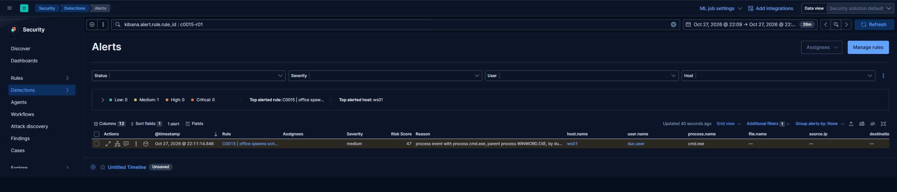


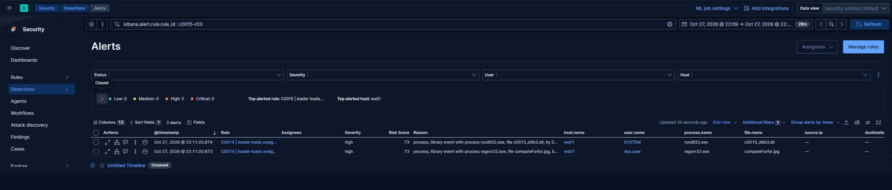

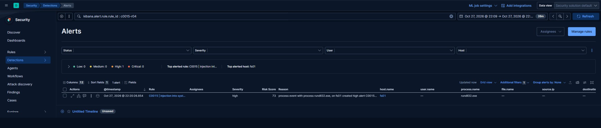


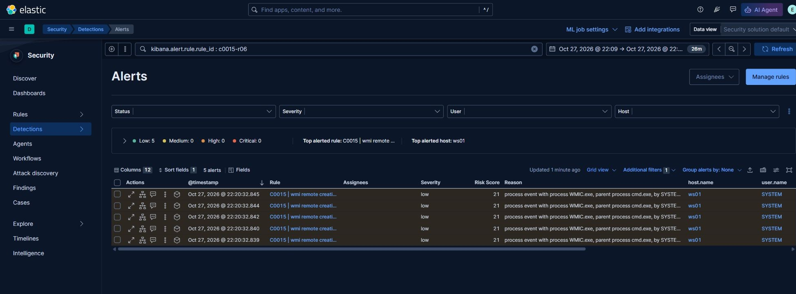

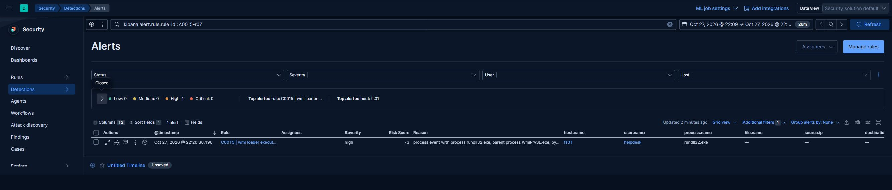

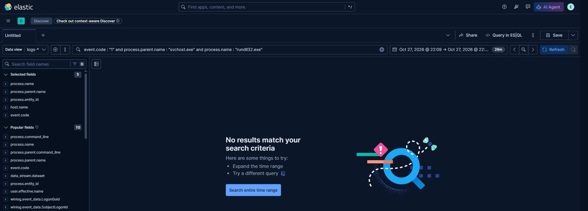


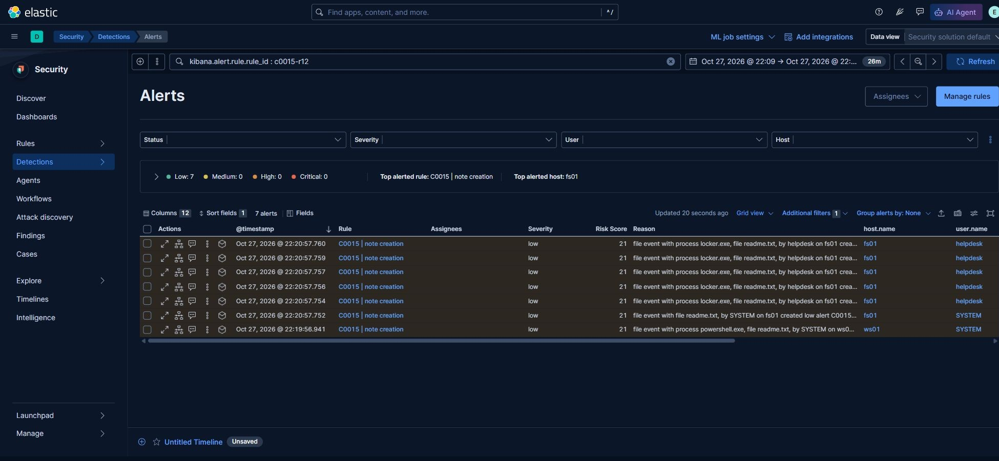

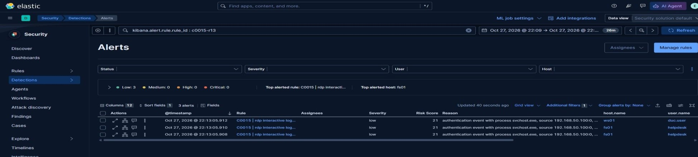

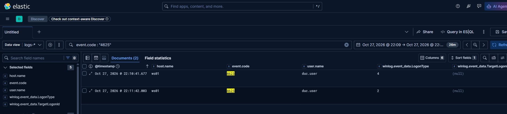

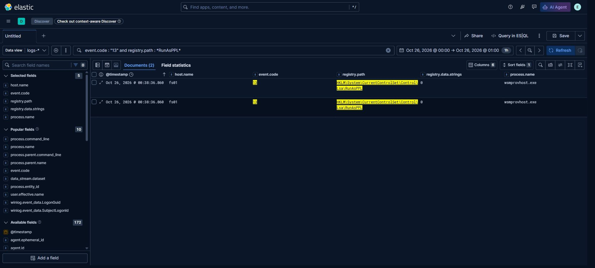

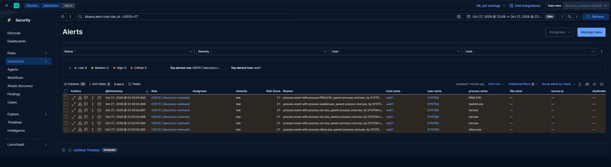

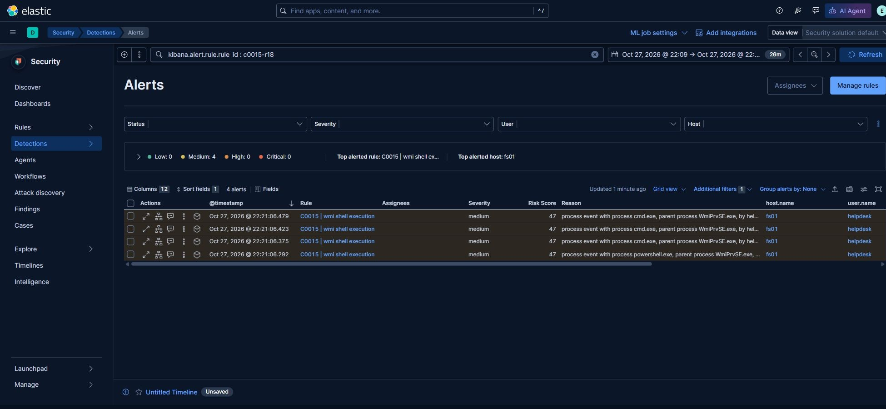
