# Detection content

The rule package is defined by [`catalog.json`](catalog.json). The table in [`INDEX.md`](INDEX.md) is
generated from it and must not be edited by hand:

```
python3 tools/detections/catalog.py --check     # verify package (CI gate)
python3 tools/detections/catalog.py --index     # regenerate INDEX.md
python3 tools/detections/catalog.py --update    # refresh content hashes
```

`--check` fails on a rule file that is absent, untracked, ignored by `.gitignore`, changed without a
catalog update, referenced twice, or present on disk without a catalog entry.

## What a catalog entry carries

| Field | Meaning |
|---|---|
| `id` | stable identifier (`C0015-R01`); retired ids are never reused |
| `revision` | incremented when the query or its claim changes |
| `file` + `sha256` | the query and a content hash |
| `status` | `shipped` or `retired`; retired entries keep a reason and no file |
| `role` | `alert`, `building_block`, `enrichment`, or `hunt` |
| `severity`, `risk_score` | used when the rule is imported |
| `attck` | tactic and technique id, no more than the query supports |
| `prerequisites` | the events and configuration the query depends on |
| `limitations` | what the query does not prove |
| `deployment` | index patterns, timestamp field, interval, lookback, `max_signals`, enabled state |
| `validation` | the stack, window, match count and truncation flag from the last engine run |

## Roles

- **alert** - a behaviour worth an analyst's attention on its own.
- **building_block** - a precise observation that is too common to alert alone; meant to be correlated.
- **enrichment** - context attached to another alert (interactive logon, operator habit).
- **hunt** - a starting point for a hypothesis, not a detector.

The role is part of the claim. A `building_block` described in prose as a finished detection is a
documentation bug, not a detection.

## Deployment contract

Every entry records the index patterns, the timestamp field, the schedule and the signal cap that are
applied by `tools/detections/kibana_bundle.py`. That tool builds the payload from the catalog and applies
it as an explicit operator step, gated on `KIBANA_PASS`, and it maps the catalog role to the deployment:
rules whose role is `building_block` are created with `building_block_type: default`, and no rule is
given a notification action. Nothing runs in CI.

Two things must stay true when the rules are imported into a stack:

1. the index patterns must match the data the sensors actually write, and
2. the field names in the queries must exist in that pipeline.

Neither is proven by a query parsing. See the evidence schema in
[`evidence/schema/export-v1.schema.json`](../evidence/schema/export-v1.schema.json)
for the fields an export must carry to be checkable.
## Validation status

Per-hit classification and provenance: [`validation.md`](validation.md). The 48 alert documents with their source locators: [`run-6-alerts.md`](run-6-alerts.md).

All eighteen shipped rules were run with `detections/tools/engine_check.py` against Elasticsearch 9.5.3 on the
window `2026-11-21T11:45Z -> 2026-11-21T12:10Z`, the run that exercised the current chain (document, agent, injection, discovery, credential, WMI, persistence, exfiltration, impact). Every query
parsed and every field it names exists in this pipeline; the matches are in each catalog entry.

| Rule | Matches | Behaviour |
|---|---|---|
| R01 | 2 | office spawns script host |
| R02 | 1 | script host starts loader |
| R03 | 1 | loader loads untrusted module |
| R04 | 1 | agent executes planted script |
| R05 | 2 | LSA secrets requested |
| R06 | 2 | defender real-time protection disable requested |
| R07 | 3 | wmi remote process creation |
| R08 | 3 | wmi hosted child process |
| R10 | 1 | shadow copy deletion requested |
| R11 | 1 | rclone transfer invocation |
| R12 | 1 | locker simulator invocation |
| R13 | 1 | script written into agent checks |
| R14 | 6 | remote thread into service host |
| R15 | 7 | module loaded from user path |
| R16 | 3 | campaign-domain lookup |
| R17 | 9 | same process resolves the domain then connects |
| R18 | 3 | domain and trust discovery |
| R19 | 1 | boot task creation requested |

A match is not a verdict: the engine check proves the query and the fields, not precision. Every rule
fires on this chain and every rule is an alert.

## Field notes

- `E7` carries the module in `dll.path` and the trust verdict in `dll.code_signature.trusted`, not in
  `winlog.event_data.ImageLoaded`.
- The captured run produced no `E11` document for the corpus note or for the renamed files, which is why R12
  keys on the locker command line. Whether the profile filtered them or they never reached ingest was not
  established; do not attribute it to the profile without checking FS01.
- `E11` for the planted script carries `file.path` and `process.name` (`regsvr32.exe`), which is what R13
  joins on; the same document repeated, so a hit count is not a write count.

Screenshots from the run: [`docs/evidence/run-6/README.md`](../docs/evidence/run-6/README.md).

## Alert views (run-6)

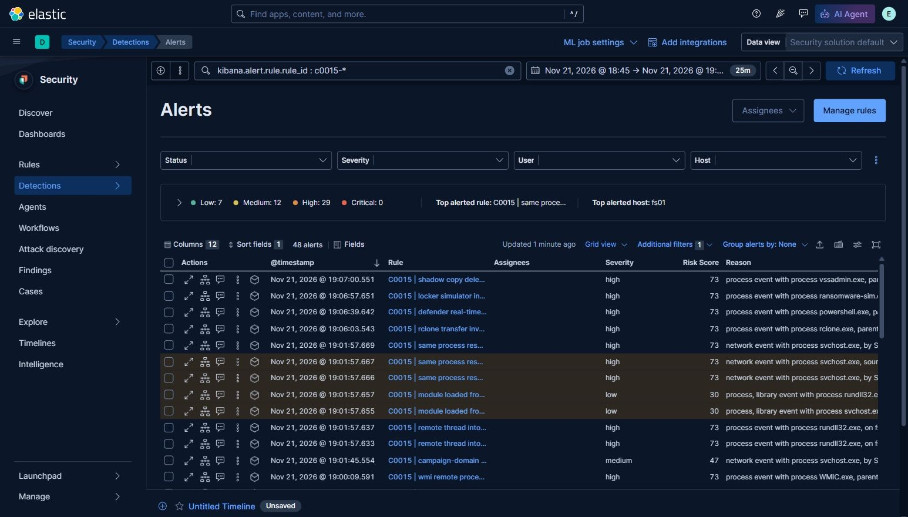

All 48 C0015 alert documents in the window.

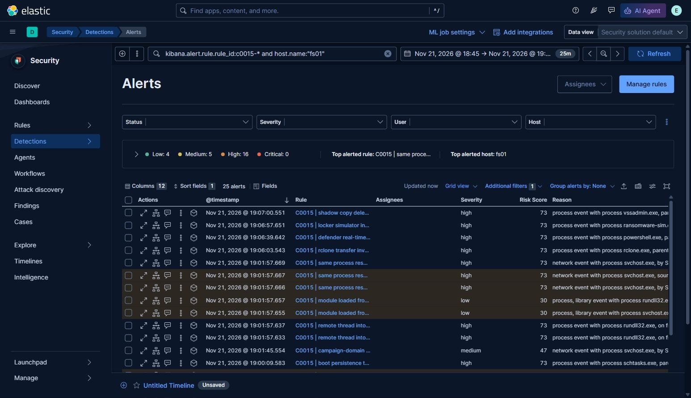

Alerts per host: `fs01`.

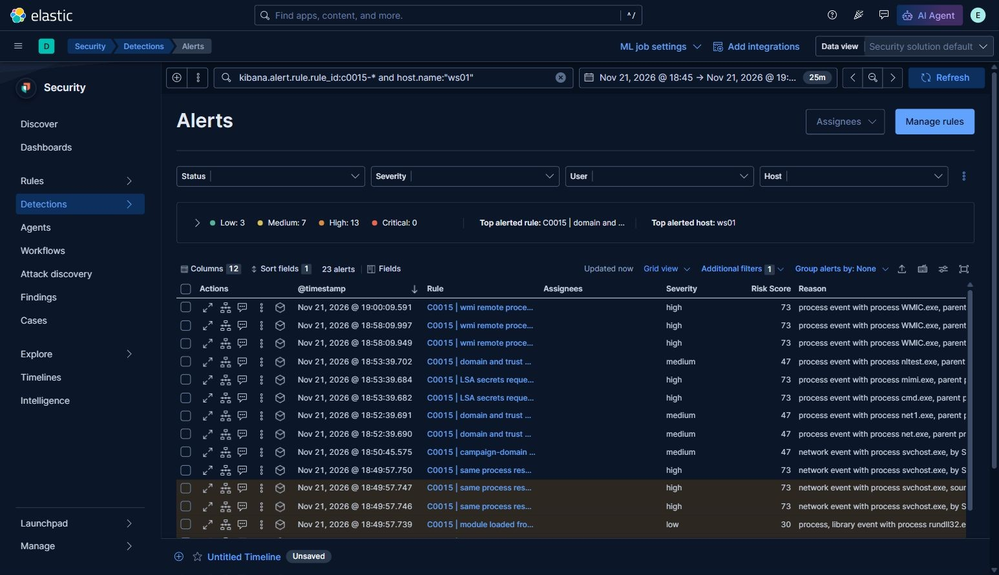

Alerts per host: `ws01`.

### One rule at a time


`c0015-r01` on its own.


`c0015-r02` on its own.

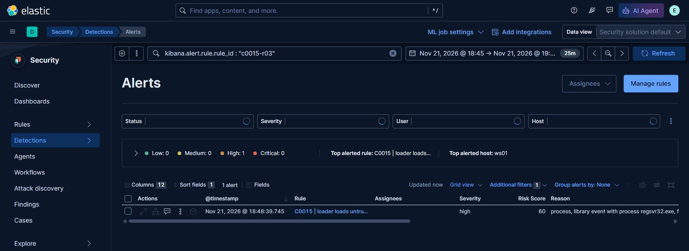

`c0015-r03` on its own.


`c0015-r04` on its own.

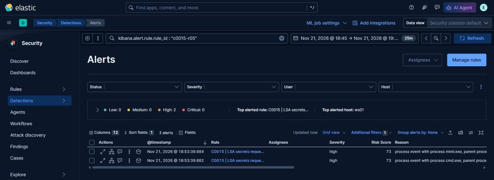

`c0015-r05` on its own.


`c0015-r06` on its own.

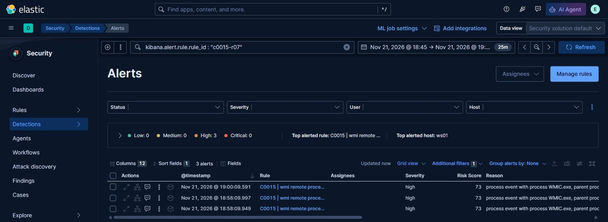

`c0015-r07` on its own.

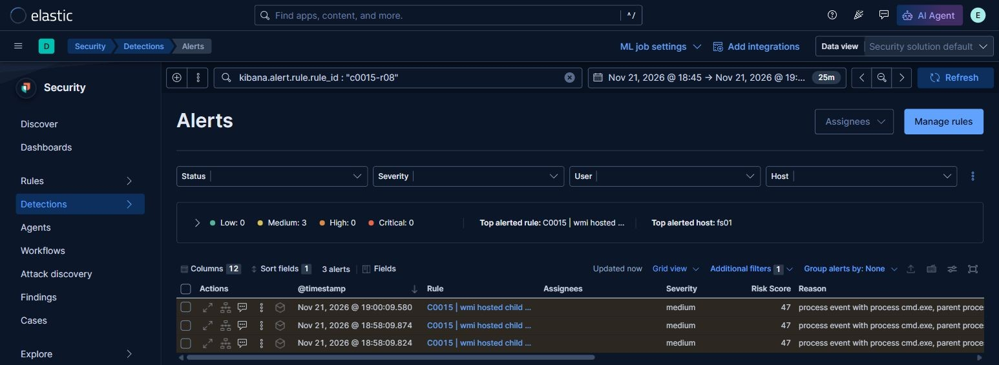

`c0015-r08` on its own.


`c0015-r10` on its own.


`c0015-r11` on its own.


`c0015-r12` on its own.

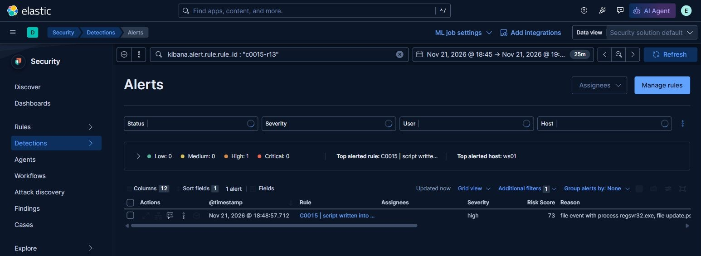

`c0015-r13` on its own.

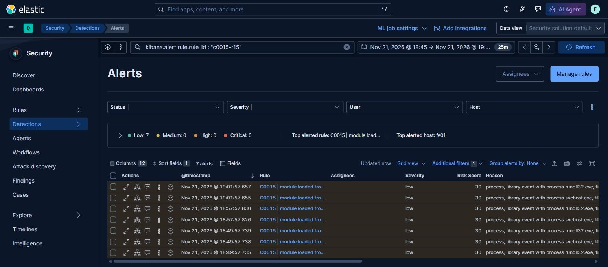

`c0015-r15` on its own.


`c0015-r16` on its own.

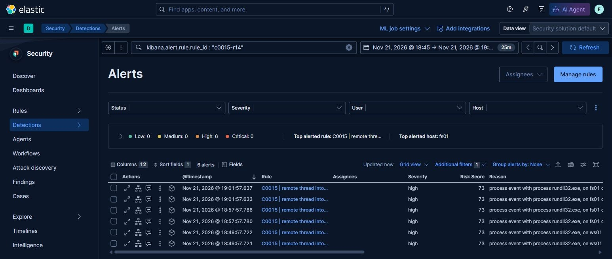

`c0015-r14` on its own.

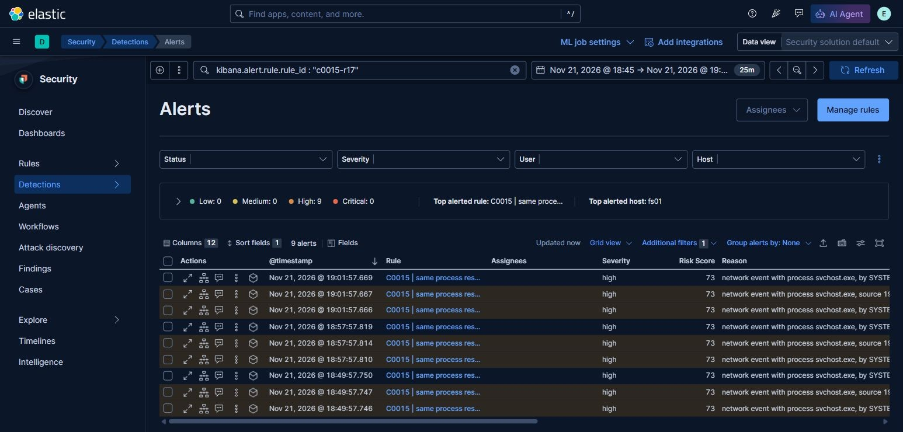

`c0015-r17` on its own.

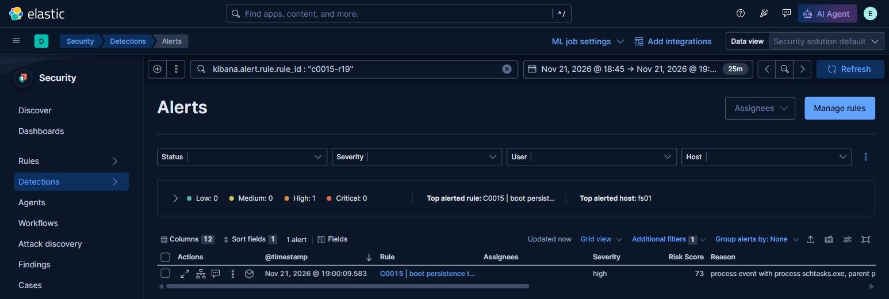

`c0015-r19` on its own.
