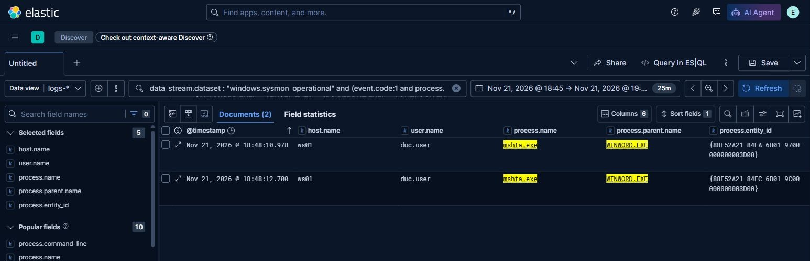

# Query 1 - Office starts a script host

## KQL

```
event.code:1 and process.parent.name:("WINWORD.EXE" or "EXCEL.EXE" or "POWERPNT.EXE" or "OUTLOOK.EXE") and process.name:("mshta.exe" or "cmd.exe" or "wscript.exe" or "cscript.exe" or "powershell.exe")
```

## Result



Office starts a script host.

Technique: `kill-chain/techniques/delivery-macro-document/`. Run: `run-6`, 2026-11-21. Source frame: `run6-01-office-starts-a-script-host.jpg`.
