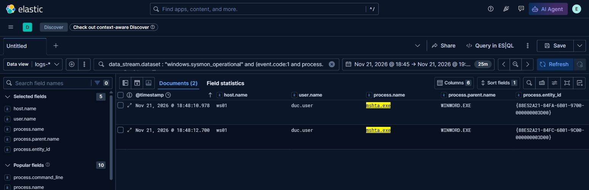

# Query 2 - HTA host

## KQL

```
event.code:1 and process.name:"mshta.exe"
```

## Result



HTA host.

Technique: `kill-chain/techniques/delivery-macro-document/`. Run: `run-6`, 2026-11-21. Source frame: `run6-02-mshta.jpg`.
