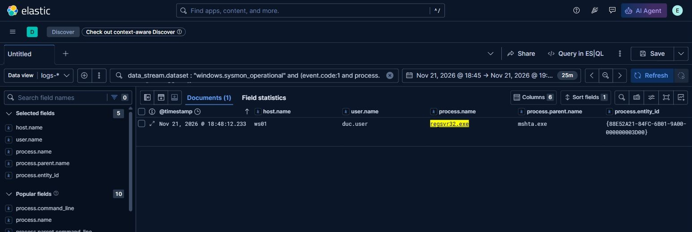

# Query 3 - Loader invocation

## KQL

```
event.code:1 and process.name:"regsvr32.exe"
```

## Result



Loader invocation.

Technique: `kill-chain/techniques/regsvr32-loader/`. Run: `run-6`, 2026-11-21. Source frame: `run6-03-loader-invocation.jpg`.
