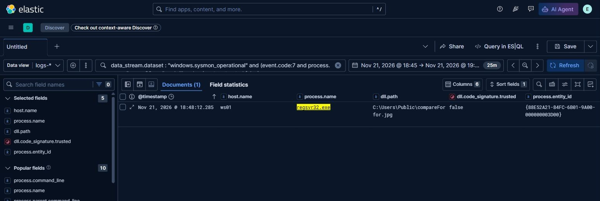

# Query 4 - Untrusted module load

## KQL

```
event.code:7 and process.name:"regsvr32.exe" and dll.code_signature.trusted:false
```

## Result



Untrusted module load.

Technique: `kill-chain/techniques/regsvr32-loader/`. Run: `run-6`, 2026-11-21. Source frame: `run6-04-untrusted-module-load.jpg`.
