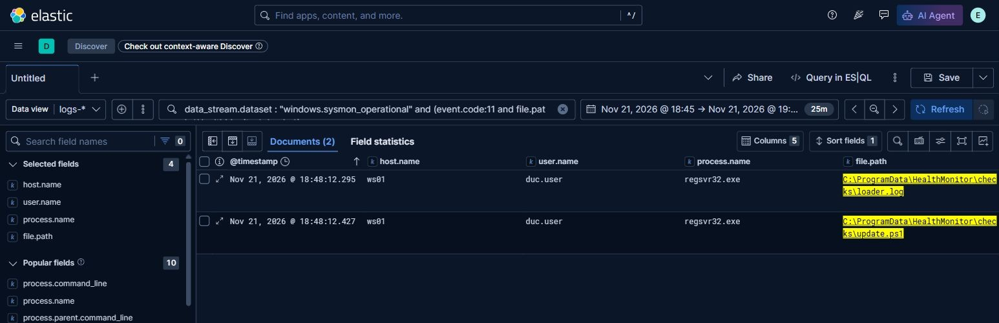

# Query 5 - Script written into the agent checks

## KQL

```
event.code:11 and file.path:*HealthMonitor*checks*
```

## Result



Script written into the agent checks.

Technique: `kill-chain/techniques/regsvr32-loader/`. Run: `run-6`, 2026-11-21. Source frame: `run6-05-script-written-into-the-agent-checks.jpg`.
