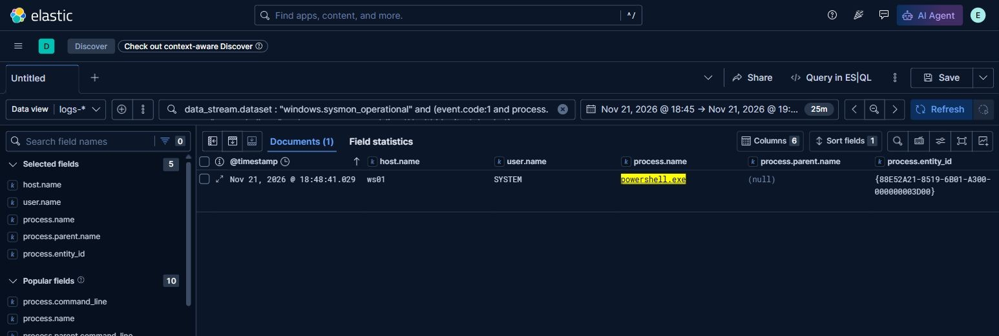

# Query 6 - Agent runs the script

## KQL

```
event.code:1 and process.name:"powershell.exe" and process.command_line:*HealthMonitor*checks*
```

## Result



Agent runs the script.

Technique: `kill-chain/techniques/agent-privilege-escalation/`. Run: `run-6`, 2026-11-21. Source frame: `run6-06-agent-runs-the-script.jpg`.
