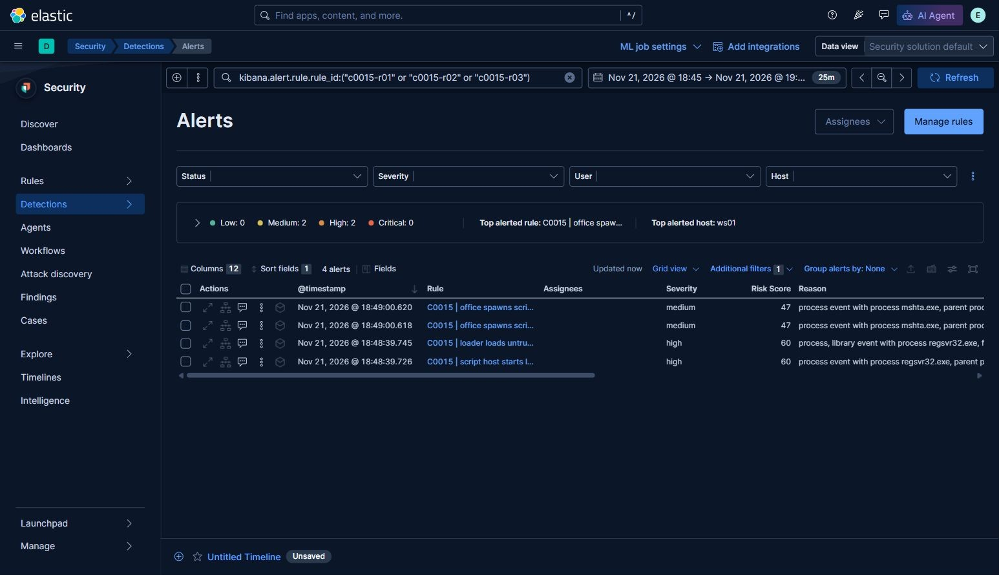

# Query 7 - All three delivery alerts

## KQL

```
kibana.alert.rule.rule_id:("c0015-r01" or "c0015-r02" or "c0015-r03")
```

## Result



All three delivery alerts.

Technique: `kill-chain/techniques/delivery-macro-document/`. Run: `run-6`, 2026-11-21. Source frame: `run6-07-all-three-delivery-alerts.jpg`.
