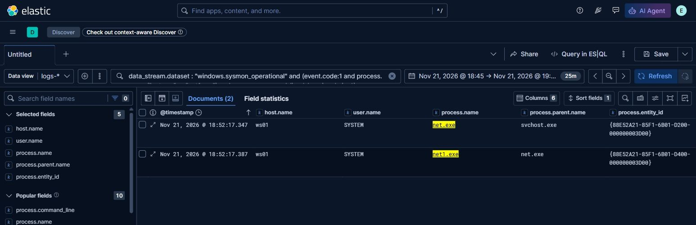

# Query 8 - Domain group enumeration

## KQL

```
event.code:1 and process.name:("net.exe" or "net1.exe") and process.command_line:*domain admins*
```

## Result



Domain group enumeration.

Technique: `kill-chain/techniques/discovery/`. Run: `run-6`, 2026-11-21. Source frame: `run6-08-domain-group-enumeration.jpg`.
