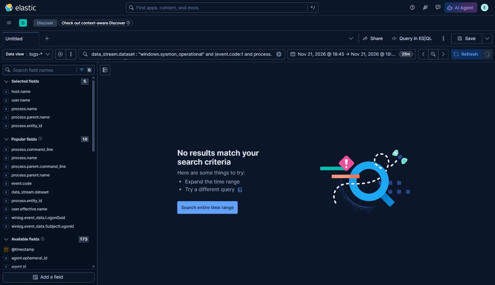

# Query 11 - Connectivity check

## KQL

```
event.code:1 and process.name:"ping.exe"
```

## Result



Connectivity check.

Technique: `kill-chain/techniques/discovery/`. Run: `run-6`, 2026-11-21. Source frame: `run6-11-connectivity-check.jpg`.
