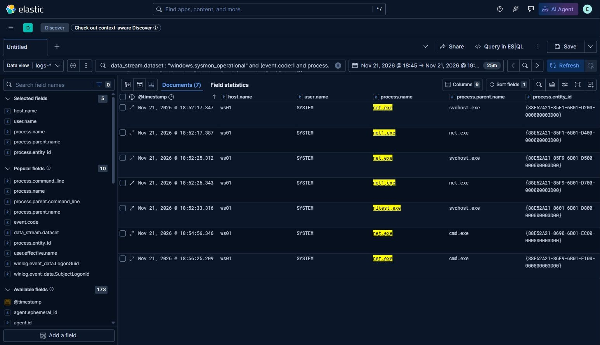

# Query 12 - All discovery events

## KQL

```
event.code:1 and process.name:("net.exe" or "net1.exe" or "nltest.exe" or "ping.exe" or "tasklist.exe")
```

## Result



All discovery events.

Technique: `kill-chain/techniques/discovery/`. Run: `run-6`, 2026-11-21. Source frame: `run6-12-all-discovery-events.jpg`.
