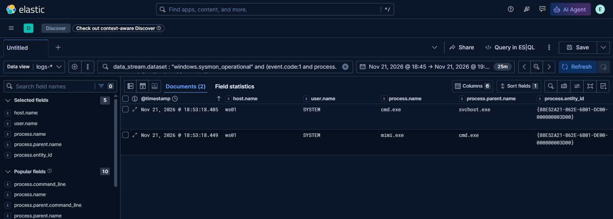

# Query 14 - LSA secret request

## KQL

```
event.code:1 and process.command_line:*lsadump::secrets*
```

## Result



LSA secret request.

Technique: `kill-chain/techniques/credential-access-lsa-secrets/`. Run: `run-6`, 2026-11-21. Source frame: `run6-14-lsa-secret-request.jpg`.
