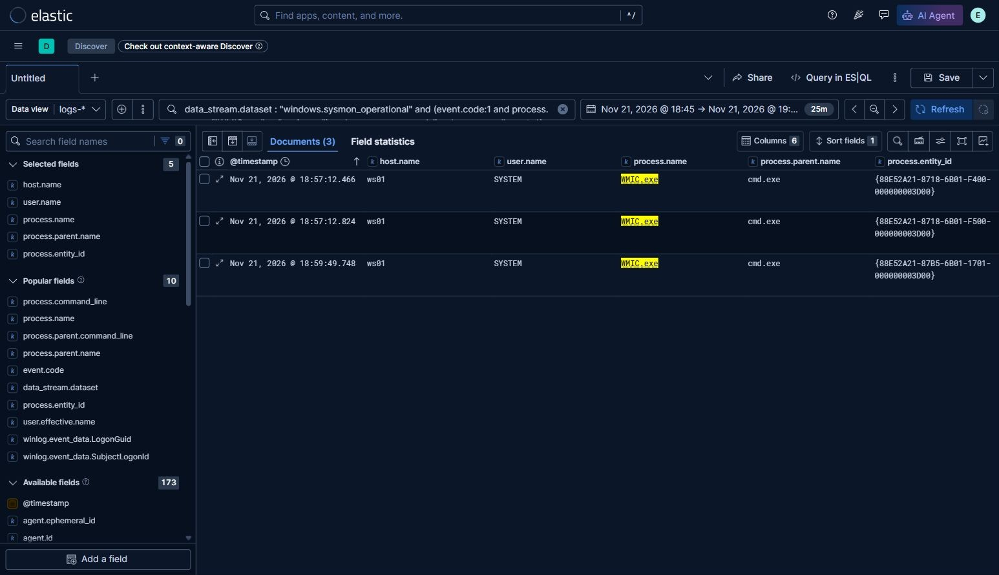

# Query 17 - Remote process creation request

## KQL

```
event.code:1 and process.name:("WMIC.exe" or "wmic.exe") and process.command_line:*process call create*
```

## Result



Remote process creation request.

Technique: `kill-chain/techniques/wmi-lateral-movement/`. Run: `run-6`, 2026-11-21. Source frame: `run6-17-remote-process-creation-request.jpg`.
