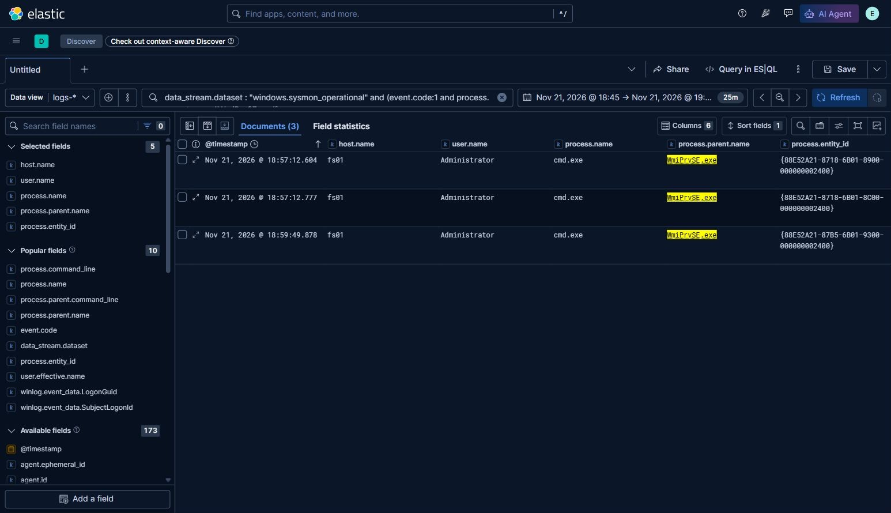

# Query 18 - WMI provider child

## KQL

```
event.code:1 and process.parent.name:"WmiPrvSE.exe"
```

## Result



WMI provider child.

Technique: `kill-chain/techniques/wmi-lateral-movement/`. Run: `run-6`, 2026-11-21. Source frame: `run6-18-wmi-provider-child.jpg`.
