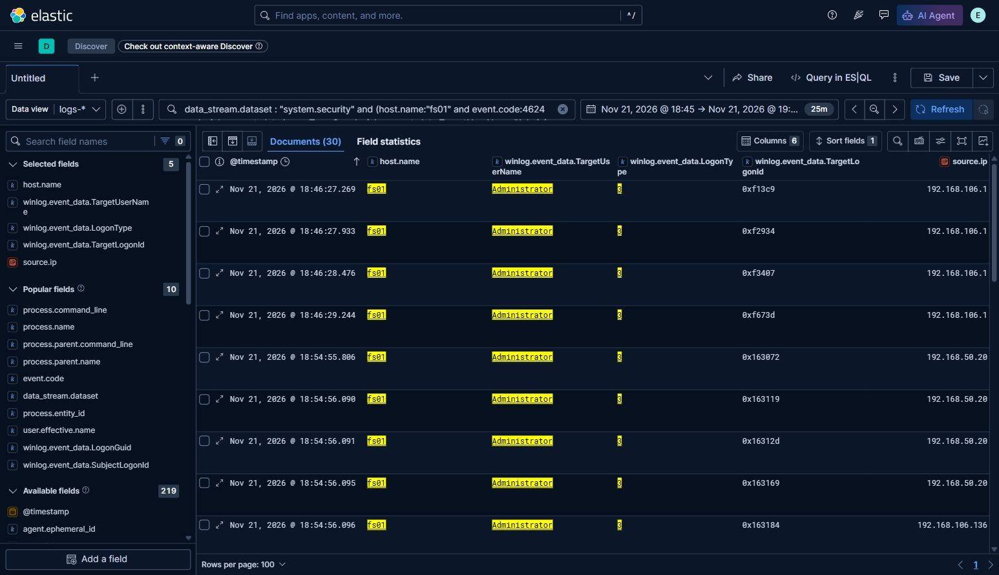

# Query 19 - Network logon on FS01

## KQL

```
event.code:4624 and winlog.event_data.LogonType:3 and winlog.event_data.TargetUserName:"Administrator"
```

## Result



Network logon on FS01.

Technique: `kill-chain/techniques/wmi-lateral-movement/`. Run: `run-6`, 2026-11-21. Source frame: `run6-19-network-logon-fs01-scoped.jpg`.
