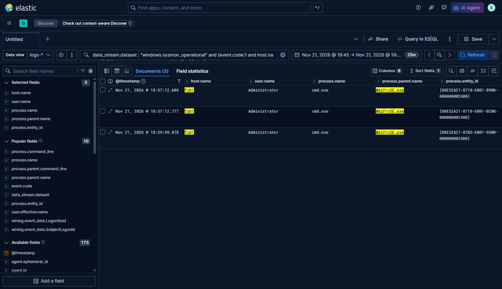

# Query 20 - WMI children on FS01

## KQL

```
event.code:1 and host.name:"fs01" and process.parent.name:"WmiPrvSE.exe"
```

## Result



WMI children on FS01.

Technique: `kill-chain/techniques/wmi-lateral-movement/`. Run: `run-6`, 2026-11-21. Source frame: `run6-20-wmi-children-on-fs01.jpg`.
