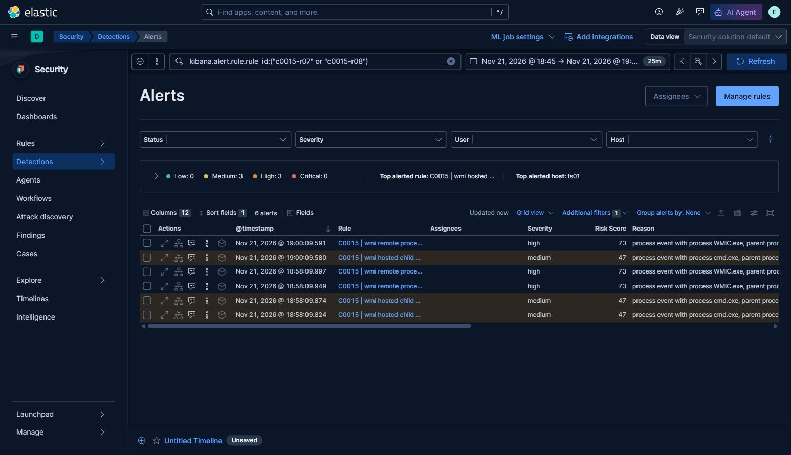

# Query 21 - R07 and R08 alerts

## KQL

```
kibana.alert.rule.rule_id:("c0015-r07" or "c0015-r08")
```

## Result



R07 and R08 alerts.

Technique: `kill-chain/techniques/wmi-lateral-movement/`. Run: `run-6`, 2026-11-21. Source frame: `run6-21-r07-and-r08-alerts.jpg`.
