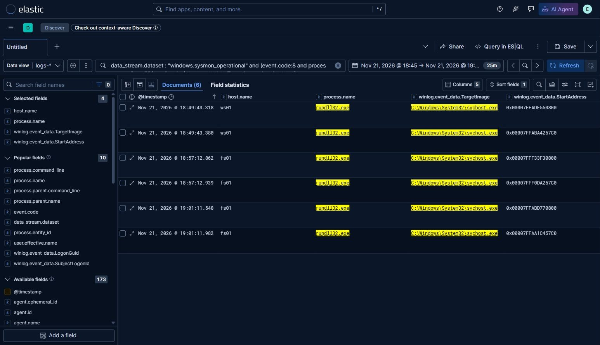

# Query 22 - Remote thread into svchost

## KQL

```
event.code:8 and process.name:"rundll32.exe" and winlog.event_data.TargetImage:*svchost.exe
```

## Result



Remote thread into svchost.

Technique: `kill-chain/techniques/process-injection/`. Run: `run-6`, 2026-11-21. Source frame: `run6-22-remote-thread-into-svchost.jpg`.
