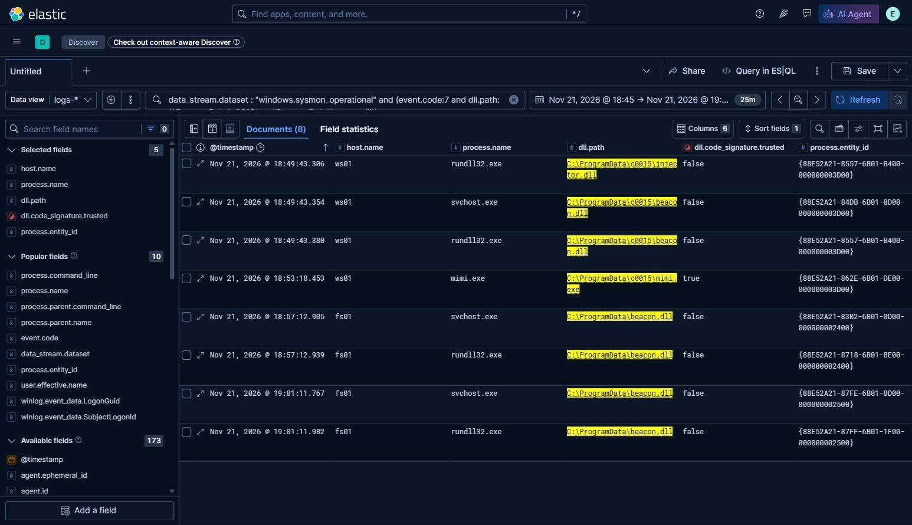

# Query 23 - Beacon module loaded

## KQL

```
event.code:7 and dll.path:(*ProgramData*c0015* or *ProgramData*beacon.dll)
```

## Result



Beacon module loaded.

Technique: `kill-chain/techniques/process-injection/`. Run: `run-6`, 2026-11-21. Source frame: `run6-23-beacon-module-loaded.jpg`.
