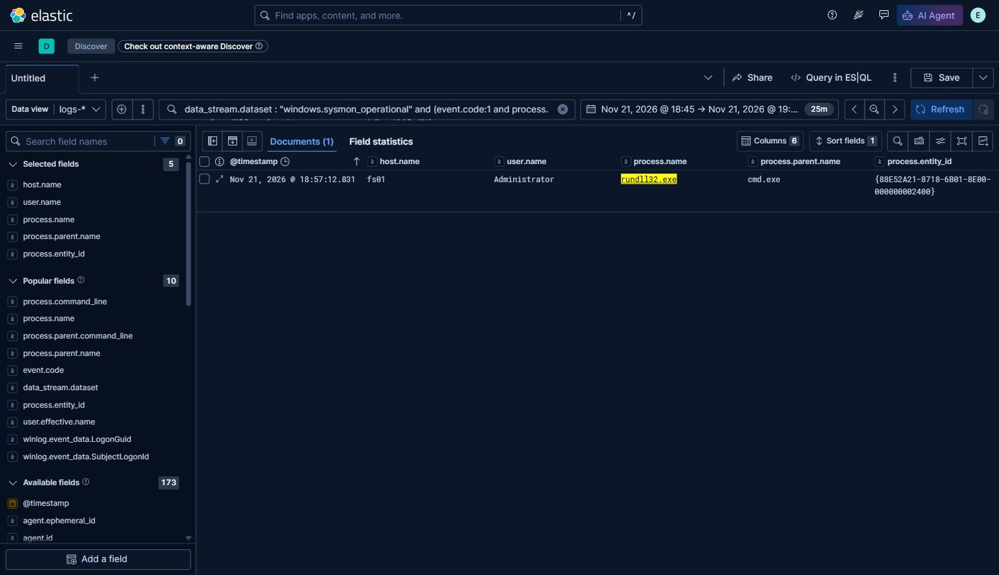

# Query 24 - Injector invocation

## KQL

```
event.code:1 and process.name:"rundll32.exe" and process.command_line:*143.dll*
```

## Result



Injector invocation.

Technique: `kill-chain/techniques/process-injection/`. Run: `run-6`, 2026-11-21. Source frame: `run6-24-injector-invocation.jpg`.
