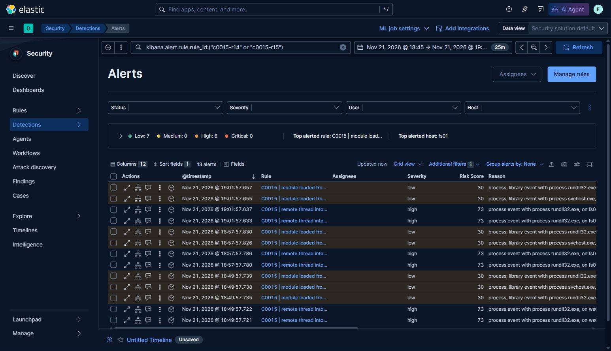

# Query 25 - R14 and R15 alerts

## KQL

```
kibana.alert.rule.rule_id:("c0015-r14" or "c0015-r15")
```

## Result



R14 and R15 alerts.

Technique: `kill-chain/techniques/process-injection/`. Run: `run-6`, 2026-11-21. Source frame: `run6-25-r14-and-r15-alerts.jpg`.
