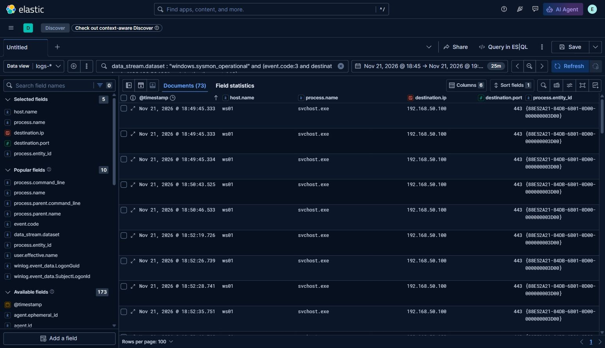

# Query 27 - Connection to the listener

## KQL

```
event.code:3 and destination.ip:"192.168.50.100" and destination.port:443
```

## Result



Connection to the listener.

Technique: `kill-chain/techniques/process-injection/`. Run: `run-6`, 2026-11-21. Source frame: `run6-27-connection-to-the-listener.jpg`.
