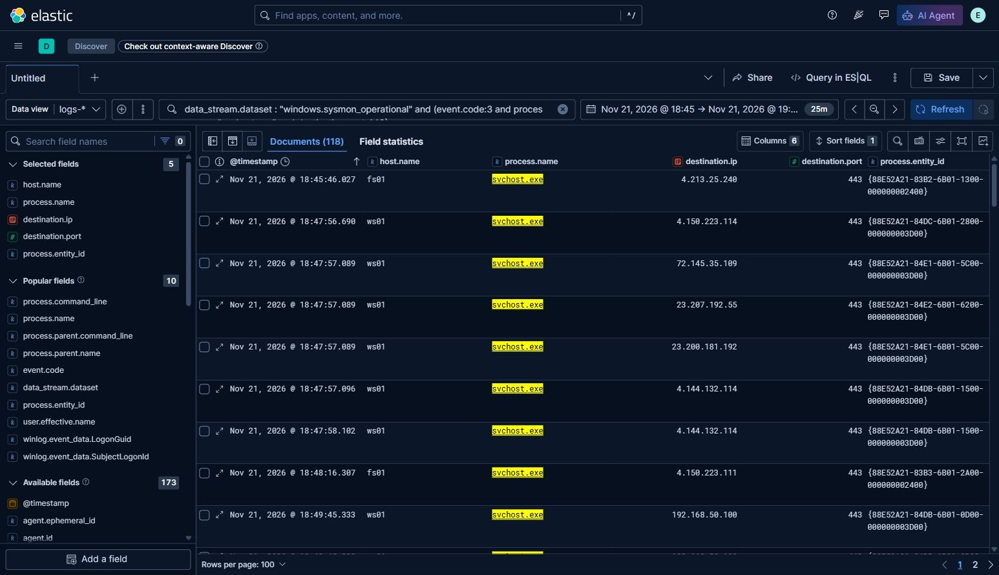

# Query 28 - svchost outbound 443

## KQL

```
event.code:3 and process.name:"svchost.exe" and destination.port:443
```

## Result



svchost outbound 443.

Technique: `kill-chain/techniques/process-injection/`. Run: `run-6`, 2026-11-21. Source frame: `run6-28-svchost-outbound-443.jpg`.
