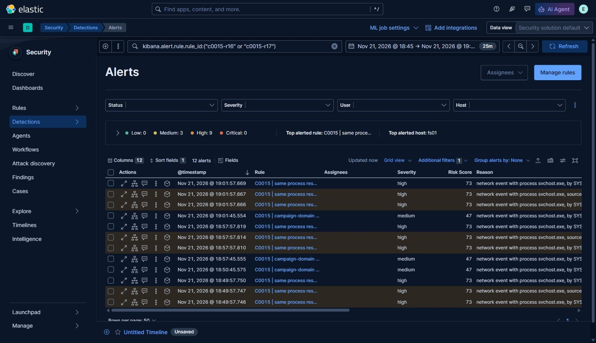

# Query 29 - R16 and R17 alerts

## KQL

```
kibana.alert.rule.rule_id:("c0015-r16" or "c0015-r17")
```

## Result



R16 and R17 alerts.

Technique: `kill-chain/techniques/process-injection/`. Run: `run-6`, 2026-11-21. Source frame: `run6-29-r16-and-r17-alerts.jpg`.
