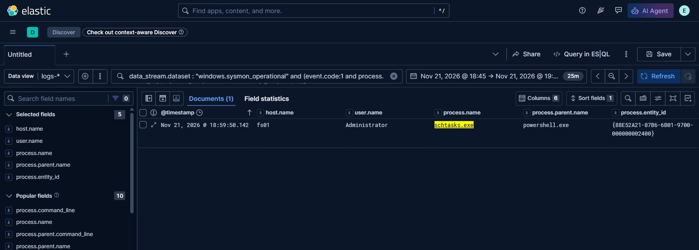

# Query 30 - Boot task creation

## KQL

```
event.code:1 and process.name:"schtasks.exe" and process.command_line:*onstart*
```

## Result



Boot task creation.

Technique: `kill-chain/techniques/wmi-lateral-movement/`. Run: `run-6`, 2026-11-21. Source frame: `run6-30-boot-task-creation.jpg`.
