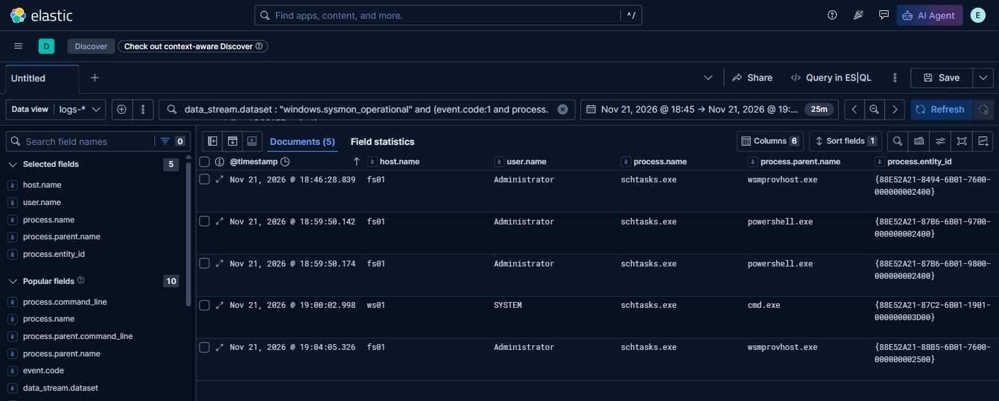

# Query 31 - Task by name

## KQL

```
event.code:1 and process.command_line:*C0015Persist*
```

## Result



Task by name.

Technique: `kill-chain/techniques/wmi-lateral-movement/`. Run: `run-6`, 2026-11-21. Source frame: `run6-31-task-by-name.jpg`.
