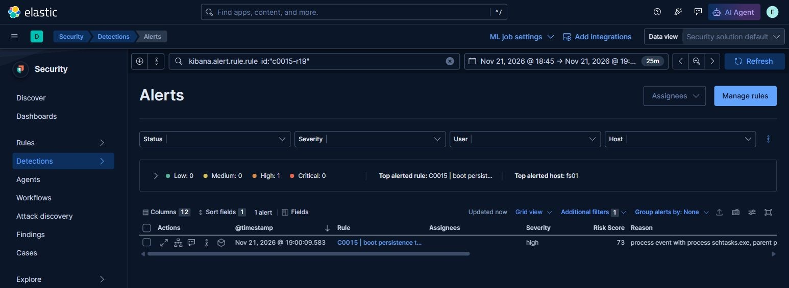

# Query 32 - R19 alert

## KQL

```
kibana.alert.rule.rule_id:"c0015-r19"
```

## Result



R19 alert.

Technique: `kill-chain/techniques/wmi-lateral-movement/`. Run: `run-6`, 2026-11-21. Source frame: `run6-32-r19-alert.jpg`.
