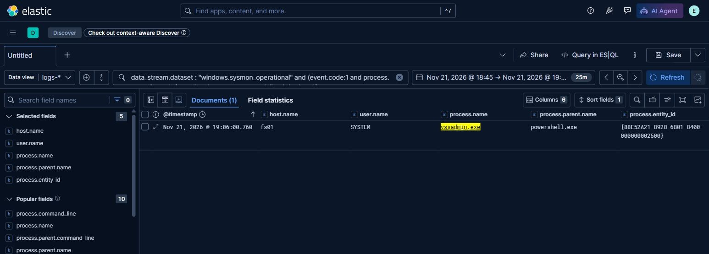

# Query 34 - Shadow copy deletion

## KQL

```
event.code:1 and process.name:"vssadmin.exe" and process.command_line:*shadows*
```

## Result



Shadow copy deletion.

Technique: `kill-chain/techniques/conti-ransomware/`. Run: `run-6`, 2026-11-21. Source frame: `run6-34-shadow-copy-deletion.jpg`.
