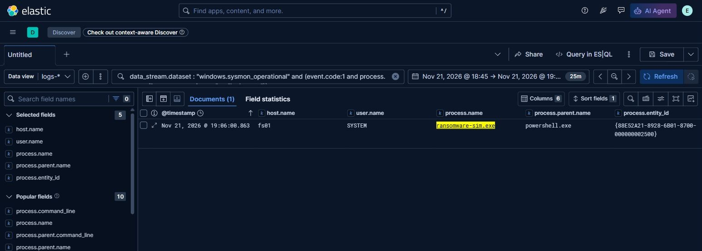

# Query 35 - Locker invocation

## KQL

```
event.code:1 and process.name:("ransomware-sim.exe" or "locker.exe")
```

## Result



Locker invocation.

Technique: `kill-chain/techniques/conti-ransomware/`. Run: `run-6`, 2026-11-21. Source frame: `run6-35-locker-invocation.jpg`.
