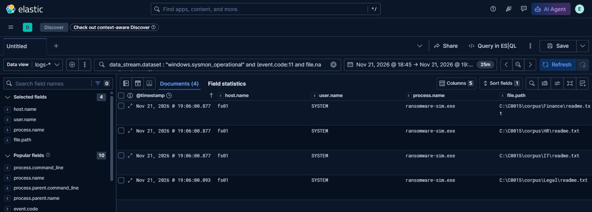

# Query 36 - Notes written

## KQL

```
event.code:11 and file.name:"readme.txt"
```

## Result



Notes written.

Technique: `kill-chain/techniques/conti-ransomware/`. Run: `run-6`, 2026-11-21. Source frame: `run6-36-notes-written.jpg`.
