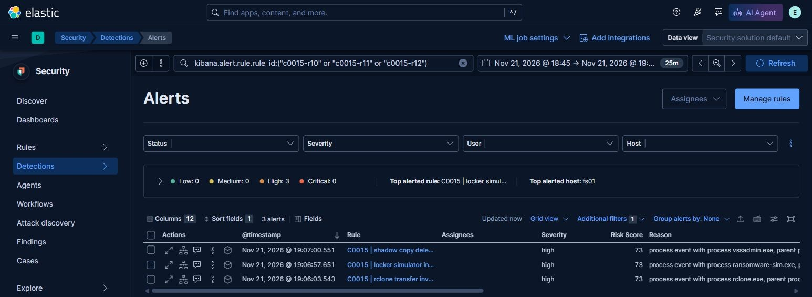

# Query 38 - R10, R11, R12 alerts

## KQL

```
kibana.alert.rule.rule_id:("c0015-r10" or "c0015-r11" or "c0015-r12")
```

## Result



R10, R11, R12 alerts.

Technique: `kill-chain/techniques/conti-ransomware/`. Run: `run-6`, 2026-11-21. Source frame: `run6-38-r10-r11-r12-alerts.jpg`.
