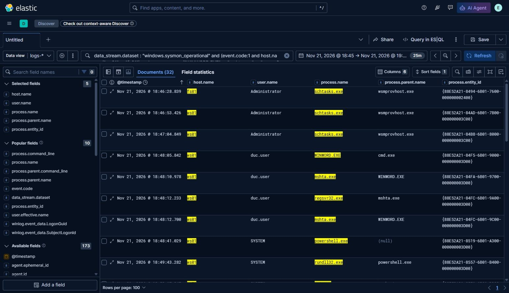

# Query 39 - Process chain on both hosts

## KQL

```
event.code:1 and host.name:("ws01" or "fs01") and process.name:("WINWORD.EXE" or "mshta.exe" or "regsvr32.exe" or "powershell.exe" or "rundll32.exe" or "mimi.exe" or "net.exe" or "net1.exe" or "nltest.exe" or "WMIC.exe" or "schtasks.exe" or "rclone.exe" or "vssadmin.exe" or "ransomware-sim.exe")
```

## Result



Process chain on both hosts.

Technique: `kill-chain/techniques/kill-chain/`. Run: `run-6`, 2026-11-21. Source frame: `run6-39-process-chain-on-both-hosts.jpg`.
