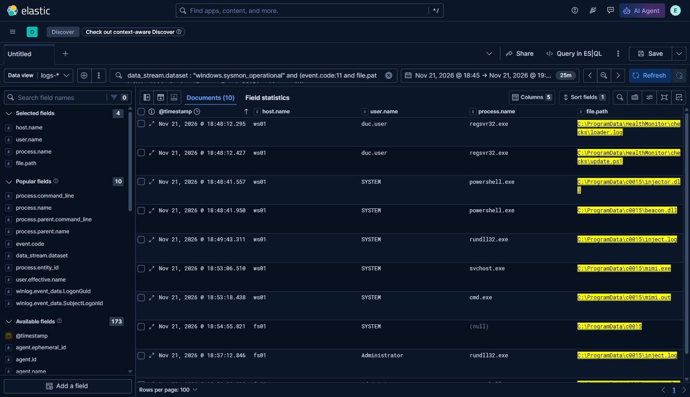

# Query 40 - All file writes of interest

## KQL

```
event.code:11 and file.path:(*HealthMonitor* or *ProgramData*c0015* or */corpus/*)
```

## Result



All file writes of interest.

Technique: `kill-chain/techniques/kill-chain/`. Run: `run-6`, 2026-11-21. Source frame: `run6-40-all-file-writes-of-interest.jpg`.
