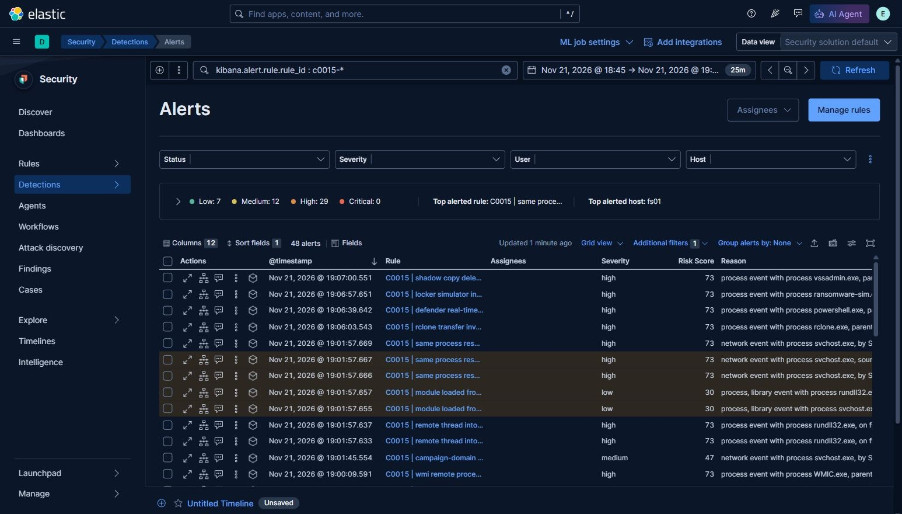

# Query 42 - All C0015 alerts

## KQL

```
kibana.alert.rule.rule_id: c0015-*
```

Security -> Alerts, absolute range 2026-11-21 11:45-12:10 UTC. Expect 48 rows.

## Result



All C0015 alerts.

Technique: `kill-chain/techniques/detections/`. Run: `run-6`, 2026-11-21. Source frame: `run6-alerts-overview.jpg`.
