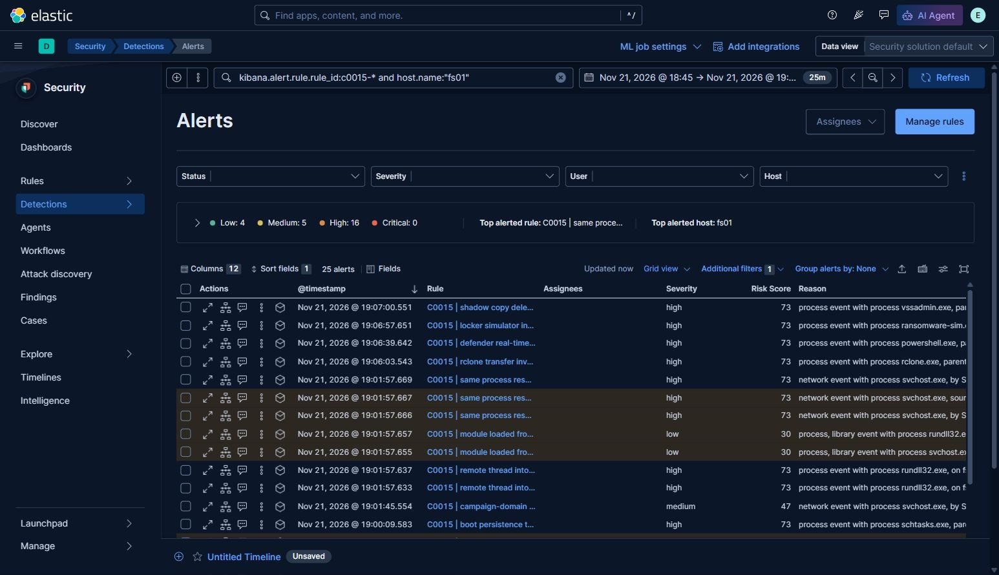
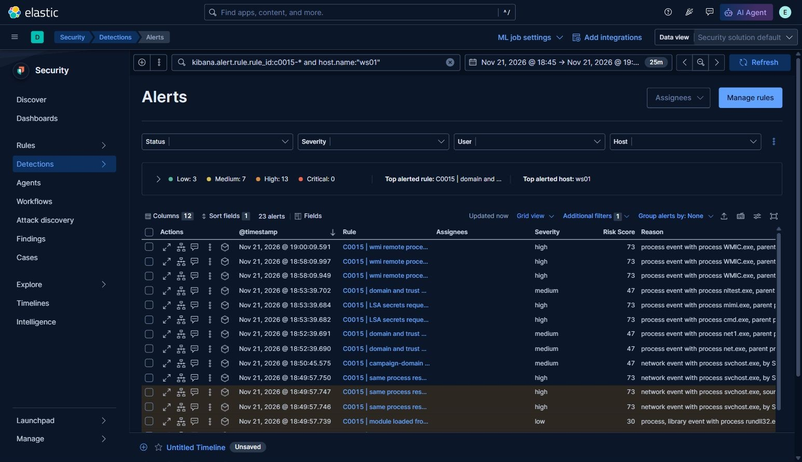

# Query 43 - Alerts per host

## KQL

```
kibana.alert.rule.rule_id: c0015-* and host.name:"ws01"
```

Security -> Alerts, the same range, with a host filter; one screenshot per host.

## Result



Alerts per host: host `fs01`.



Alerts per host: host `ws01`.

Technique: `kill-chain/techniques/detections/`. Run: `run-6`, 2026-11-21. Source frame: `run6-43-alerts-fs01.jpg`.
