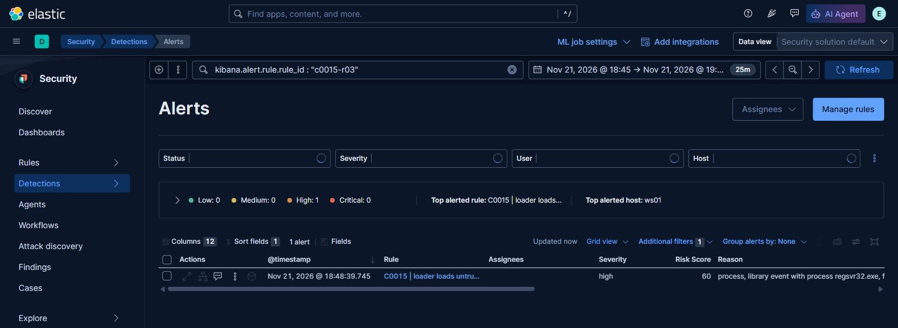
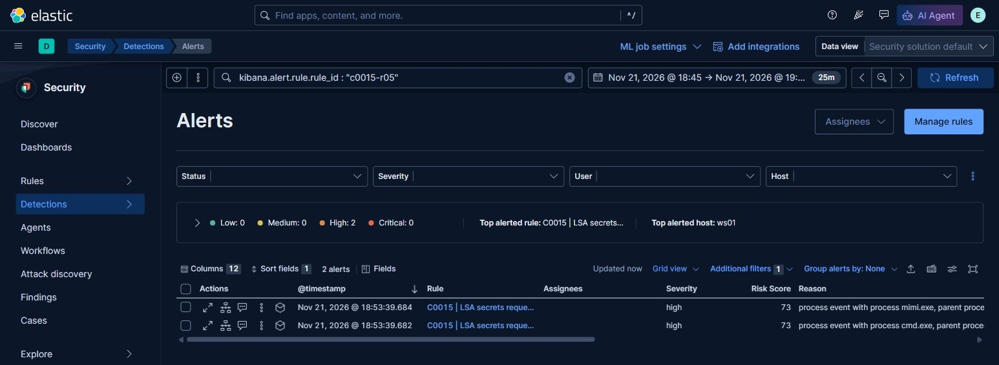
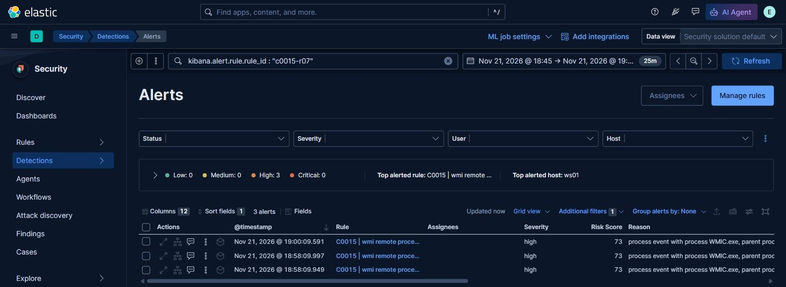
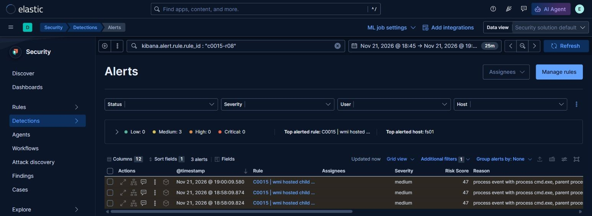
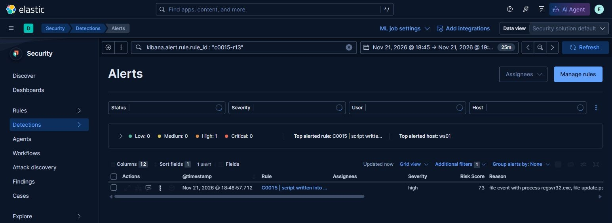
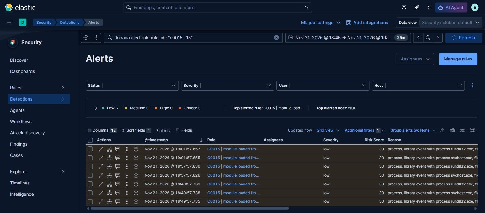
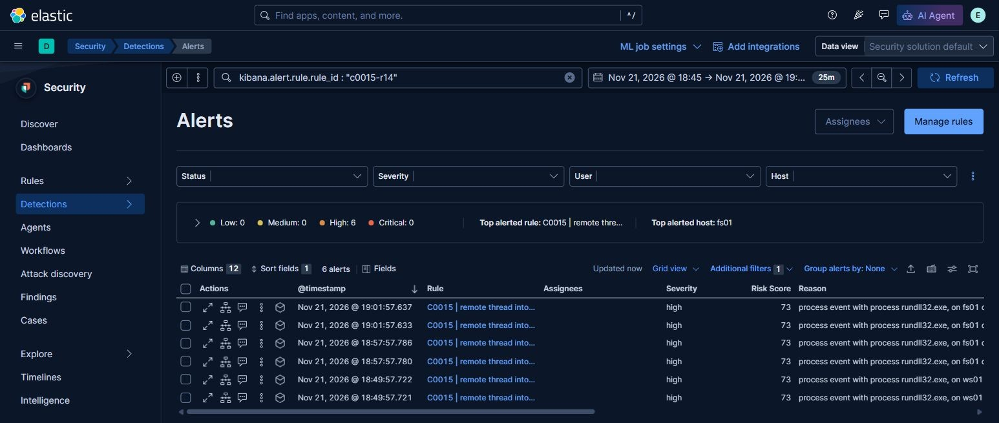
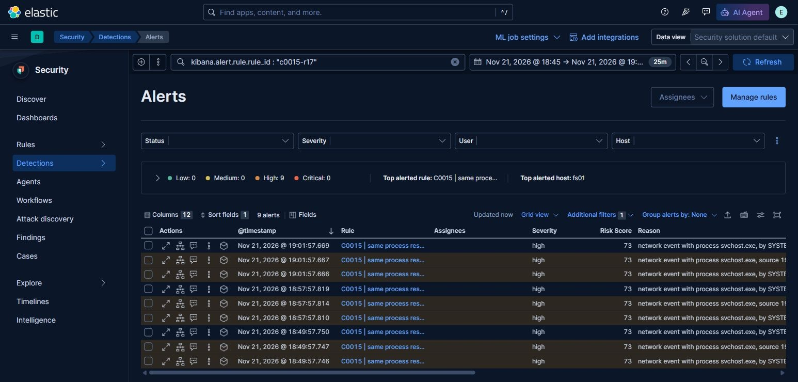
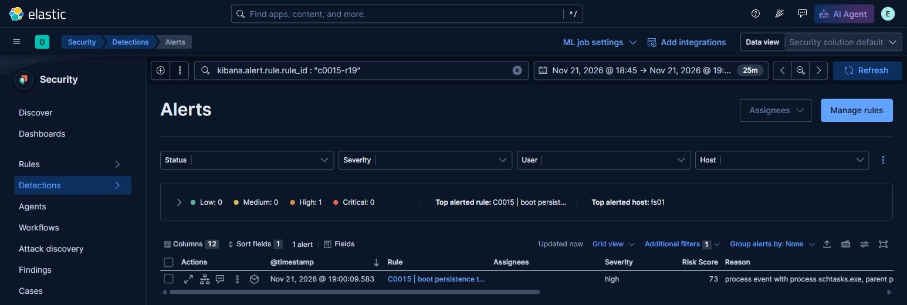

# Query 44 - One rule at a time

## KQL

```
kibana.alert.rule.rule_id: c0015-r14
```

Security -> Alerts, one screenshot per rule id (c0015-r01 ... c0015-r19, no r09).

## Result


One rule at a time: `c0015-r01`.


One rule at a time: `c0015-r02`.



One rule at a time: `c0015-r03`.


One rule at a time: `c0015-r04`.



One rule at a time: `c0015-r05`.


One rule at a time: `c0015-r06`.



One rule at a time: `c0015-r07`.



One rule at a time: `c0015-r08`.


One rule at a time: `c0015-r10`.


One rule at a time: `c0015-r11`.


One rule at a time: `c0015-r12`.



One rule at a time: `c0015-r13`.



One rule at a time: `c0015-r15`.


One rule at a time: `c0015-r16`.



One rule at a time: `c0015-r14`.



One rule at a time: `c0015-r17`.



One rule at a time: `c0015-r19`.

Technique: `kill-chain/techniques/detections/`. Run: `run-6`, 2026-11-21. Source frame: `run6-44-alerts-r01.jpg`.
