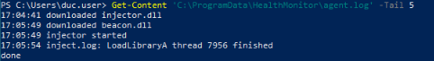
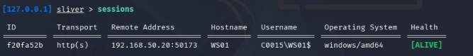

# Agent privilege escalation

| | |
|---|---|
| Chain phase | Agent privilege escalation |
| Account | duc.user -> SYSTEM |
| What happens | HealthMonitor runs the planted script as SYSTEM; the script stages the injector and the beacon DLL |
| Telemetry | Sysmon 1 (child of HealthMonitor), Sysmon 11 (script written) |
| Detection | R04 (agent child), R13 (script written) |
| Payload / tooling | agent-update.ps1, install-healthmonitor.ps1 |

## How the lab reproduces it

See [`attack-playbook/README.md`](../../../attack-playbook/README.md) for the ordered steps, the exact
commands and the checks after each step. Anything this phase writes is listed in
[`attack-playbook/payloads`](../../../attack-playbook/payloads/README.md).

## Evidence





<!-- Elastic capture for this phase: elastic-agent-privilege-escalation.png -->
<!-- Manual capture for this phase: manual-agent-privilege-escalation.png -->

Run 6, 2026-11-21, WS01. The HealthMonitor service ran the script the loader planted seven seconds
after it landed.

| UTC | Event | Locator | Excerpt |
|---|---|---|---|
| 11:48:41.029 | E1 | `AaH98O2TxY-KOnEHVHmi` | `powershell.exe -NoProfile -ExecutionPolicy Bypass -File "C:\ProgramData\HealthMonitor\checks\update.ps1"`, user `SYSTEM` |
| 11:48:41.950 | E11 | `AaH98O2TxY-KOnEHVHnf` | `update.ps1` writes `C:\ProgramData\c0015\beacon.dll` |

`C:\ProgramData\HealthMonitor\agent.log` at the same moment:

```
running update.ps1
18:48:41 update.ps1 start as nt authority\system
18:48:41 downloaded injector.dll
18:49:43 downloaded beacon.dll
18:49:43 injector started
18:49:48 inject.log: === injector done ===
done
```
