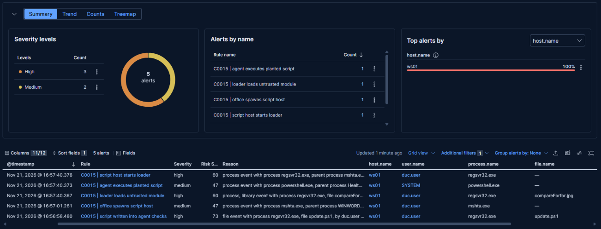

# Document and macro

| | |
|---|---|
| Chain phase | Document and macro |
| Account | duc.user |
| What happens | WINWORD.EXE runs the macro, which writes config.ini and compareforfor.hta into %PUBLIC%\C0015 and starts mshta on the HTA |
| Telemetry | Sysmon 1 (process create), Office macro telemetry |
| Detection | R01 |
| Payload / tooling | macro-payload.vba (carries the HTA and config as base64), macro-install-docm.ps1 |

## How the lab reproduces it

See [`attack-playbook/README.md`](../../../attack-playbook/README.md) for the ordered steps, the exact
commands and the checks after each step. Anything this phase writes is listed in
[`attack-playbook/payloads`](../../../attack-playbook/payloads/README.md).

## Evidence

<!-- Elastic capture for this phase: elastic-delivery-macro-document.png -->
<!-- Manual capture for this phase: manual-delivery-macro-document.png -->

Run 6, 2026-11-21, WS01. The document was opened by the autologon `duc.user` session and the whole
delivery ran in under seven seconds.

| UTC | Event | Locator | Excerpt |
|---|---|---|---|
| 11:48:05.842 | E1 | `AaH97-2TxY-KOnGPUa0V` | `"C:\Program Files\Microsoft Office\Root\Office16\WINWORD.EXE"  "C:\Users\Public\Desktop\decree-08.03.2021.docm"` (parent `cmd.exe`) |
| 11:48:10.978 | E1 | `AaH97-2TxY-KOnGPUq0_` | `mshta.exe  "C:\Users\Public\C0015\compareforfor.hta"` (parent `WINWORD.EXE`) |
| 11:48:12.233 | E1 | `AaH97-2TxY-KOnGPUq1e` | `regsvr32.exe  "C:\Users\Public\compareForfor.jpg"` (parent `mshta.exe`) |
| 11:48:12.285 | E7 | `AaH97-2TxY-KOnGPUq1n` | `regsvr32.exe` loads `C:\Users\Public\compareForfor.jpg`, `Signed=false`, user `duc.user` |
| 11:48:12.295 | E11 | `AaH97-2TxY-KOnGPUq1o` | `regsvr32.exe` writes `C:\ProgramData\HealthMonitor\checks\loader.log` |
| 11:48:12.427 | E11 | `AaH97-2TxY-KOnGPUq1y` | `regsvr32.exe` writes `C:\ProgramData\HealthMonitor\checks\update.ps1` |

The last two are the hand-off to the agent phase: the loader drops its script into the directory the
HealthMonitor service executes.
