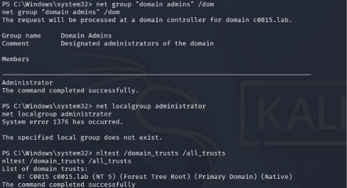
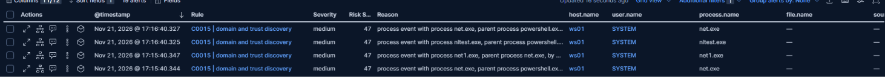

# Discovery

| | |
|---|---|
| Chain phase | Discovery |
| Account | SYSTEM |
| What happens | net, nltest, tasklist and ping from the beacon |
| Telemetry | Sysmon 1 |
| Detection | R17 |
| Payload / tooling | none; operator action |

## How the lab reproduces it

See [`attack-playbook/README.md`](../../../attack-playbook/README.md) for the ordered steps, the exact
commands and the checks after each step. Anything this phase writes is listed in
[`attack-playbook/payloads`](../../../attack-playbook/payloads/README.md).

## Evidence





<!-- Elastic capture for this phase: elastic-discovery.png -->
<!-- Manual capture for this phase: manual-discovery.png -->

Run 6, 2026-11-21, WS01, issued through the C2 session (`execute -o`), 11:52:17 - 11:52:33.

| UTC | Locator | Command |
|---|---|---|
| 11:52:17.347 | `AaH98-2TxY-KOnFQXSsf` | `net.exe group "domain admins" /dom` |
| 11:52:25.312 | `AaH98-2TxY-KOnF3XVxs` | `net.exe localgroup administrators` |
| 11:52:33.316 | `AaH98-2TxY-KOnGfXUO6` | `nltest.exe /domain_trusts /all_trusts` |

Output that mattered:

```
Group name     Domain Admins
Members
-------------------------------------------------------------------------------
Administrator

Alias name     administrators
Members
-------------------------------------------------------------------------------
Administrator
C0015\Domain Admins
Duc

List of domain trusts:
    0: C0015 c0015.lab (NT 5) (Forest Tree Root) (Primary Domain) (Native)
```

`net view /all /domain` was not run: it hangs in this lab with error 6118.
