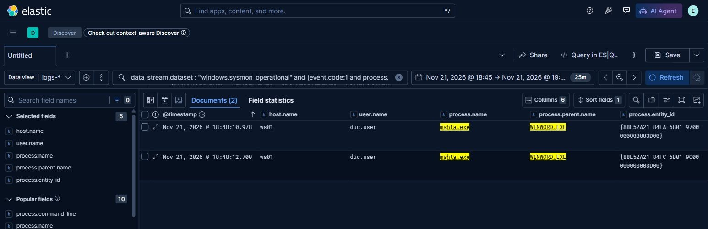
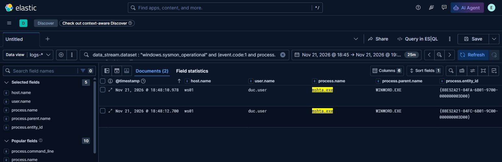
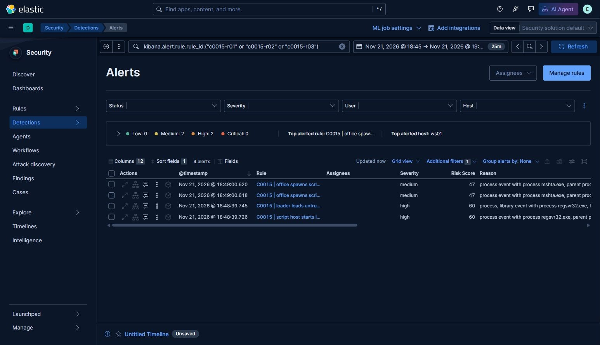

# HTA proxy execution

## Tooling

```text
mshta.exe C:\Users\Public\C0015\compareforfor.hta
the HTA starts: regsvr32.exe C:\Users\Public\compareForfor.jpg
```


| | |
|---|---|
| Chain phase | HTA proxy execution |
| Account | duc.user |
| What happens | mshta runs an .hta that starts regsvr32 on a staged file |
| Telemetry | Sysmon 1, Sysmon 3 if it fetches |
| Detection | R02 |
| Payload / tooling | compareforfor.hta |

## How the lab reproduces it

See [`attack-playbook/README.md`](../../../attack-playbook/README.md) for the ordered steps, the exact
commands and the checks after each step. Anything this phase writes is listed in
[`attack-playbook/payloads`](../../../attack-playbook/payloads/README.md).

## Evidence


Run 6, 2026-11-21, WS01.

| UTC | Event | Locator | Excerpt |
|---|---|---|---|
| 11:48:10.978 | E1 | `AaH97-2TxY-KOnGPUq0_` | `mshta.exe  "C:\Users\Public\C0015\compareforfor.hta"`, parent `WINWORD.EXE` |
| 11:48:12.233 | E1 | `AaH97-2TxY-KOnGPUq1e` | `regsvr32.exe  "C:\Users\Public\compareForfor.jpg"`, parent `mshta.exe` |

The proxy edge is the chain `WINWORD.EXE -> mshta.exe -> regsvr32.exe`: Word never starts `regsvr32`
directly.

### Query screenshots (run-6)



Office starts a script host: `WINWORD.EXE` -> `mshta.exe`, `ws01`.



The HTA host: `mshta.exe` running `compareforfor.hta`, `ws01`.



All three delivery alerts (R01, R02, R03) in the window.
