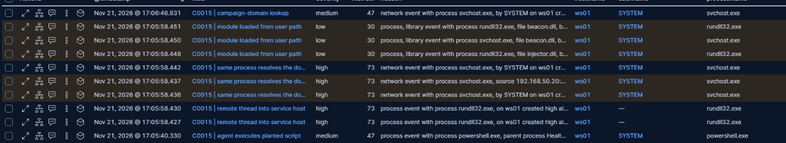
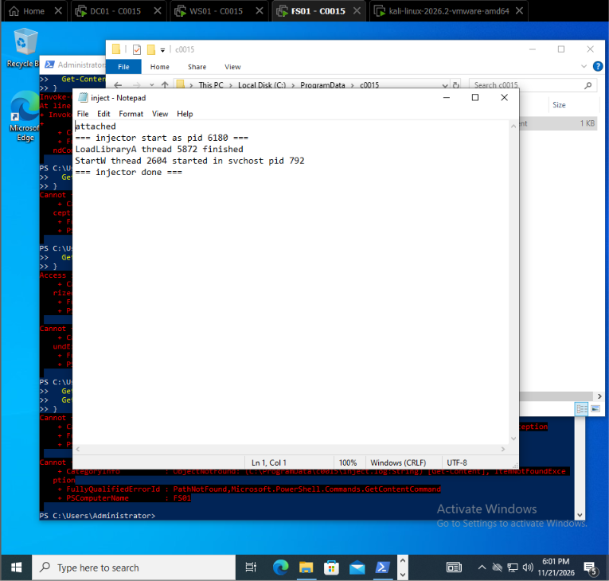

# Process injection into the service host

| | |
|---|---|
| Chain phase | Beacon hosting |
| Account | SYSTEM (injector) -> SYSTEM (svchost) |
| What happens | The agent starts `rundll32.exe injector.dll,Run`; the injector loads `beacon.dll` into a SYSTEM `svchost.exe` and calls its `StartW` export with a remote thread. On FS01 the same injector runs as `143.dll` over WMI. |
| Telemetry | Sysmon 8 (SourceImage `rundll32.exe`, TargetImage `svchost.exe`), Sysmon 7 (`dll.path` under `C:\ProgramData\c0015`), Sysmon 1 for the rundll32 command line |
| Detection | R14 (remote thread into svchost), R15 (module loaded from the staging directory), R08 (WmiPrvSE child on FS01) |
| Payload / tooling | `injector.c` (rundll32 DLL), `beacon.dll` (Sliver shared library), `agent-update.ps1` |

## How the lab reproduces it

The injector enables `SeDebugPrivilege`, finds a `svchost.exe` whose token is `S-1-5-18`, writes the
beacon path into the target, runs `LoadLibraryA` remotely, then calls the DLL's `StartW` export with a
second remote thread. The beacon lives in the service host, not in a process of its own.

## Evidence





Kibana, WS01, 2026-11-21 17:05. One injection produced ten alert documents, and that is the expected
shape:

| Rule | Rows | Why |
|---|---|---|
| R14 | 2 | two remote threads per injection (`LoadLibraryA`, then `StartW`) |
| R15 | 3 | module loads: `injector.dll` by `rundll32`, `beacon.dll` by `rundll32` and by `svchost` |
| R16 | 1 | the DNS lookup for the campaign domain |
| R17 | 3 | one sequence is three documents: the two component events plus the sequence alert |
| R04 | 1 | the agent ran the planted script |

R17's three rows are one incident, not three; R14's two rows are one injection. Count incidents by the
sequence and by the injection, not by alert document.

## Run 6 capture

Two injections in one window: the delivery beacon on WS01 and the WMI-delivered beacon on FS01.

| UTC | Host | Event | Locator | Excerpt |
|---|---|---|---|---|
| 11:49:43.306 | ws01 | E7 | `AaH98O2TxY-KOnH9V95s` | `rundll32.exe` loads `C:\ProgramData\c0015\injector.dll` |
| 11:49:43.318 | ws01 | E8 | `AaH98O2TxY-KOnH9V95v` | `rundll32.exe` -> `C:\Windows\System32\svchost.exe` |
| 11:49:43.354 | ws01 | E7 | `AaH98O2TxY-KOnH9V96C` | `svchost.exe` loads `C:\ProgramData\c0015\beacon.dll` |
| 11:57:12.846 | fs01 | E7 | `AaH99-2TxY-KOnHkaKZA` | `rundll32.exe` loads `C:\ProgramData\143.dll` |
| 11:57:12.862 | fs01 | E8 | `AaH99-2TxY-KOnHkaKY_` | `rundll32.exe` -> `svchost.exe` |
| 11:57:12.905 | fs01 | E7 | `AaH99-2TxY-KOnHkaKZT` | `svchost.exe` loads `C:\ProgramData\beacon.dll` |

`C:\ProgramData\c0015\inject.log` on WS01:

```
attached
=== injector start as pid 5868 ===
LoadLibraryA thread 8452 finished
StartW thread 8044 started in svchost pid 776
=== injector done ===
```

`C:\ProgramData\c0015\inject.log` on FS01:

```
attached
=== injector start as pid 2092 ===
LoadLibraryA thread 376 finished
StartW thread 4972 started in svchost pid 776
=== injector done ===
```

Sliver `sessions` after each injection: WS01 `8f250992` in `svchost.exe` (776), FS01 `e6e3abfb` in
`svchost.exe` (776). After the FS01 reboot a new session `51cd245d` appeared in `svchost.exe` (772),
which is the boot-task beacon rather than the injected one.
