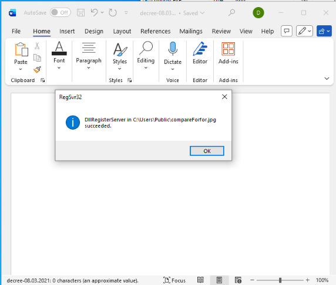
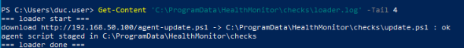

# Loaders and unsigned module

| | |
|---|---|
| Chain phase | Loaders and unsigned module |
| Account | duc.user |
| What happens | regsvr32 loads the staged .jpg as a module; the loader writes the agent script |
| Telemetry | Sysmon 1, Sysmon 7 (image load), Sysmon 11 |
| Detection | R03 |
| Payload / tooling | loader-regsvr32.c |

## How the lab reproduces it

See [`attack-playbook/README.md`](../../../attack-playbook/README.md) for the ordered steps, the exact
commands and the checks after each step. Anything this phase writes is listed in
[`attack-playbook/payloads`](../../../attack-playbook/payloads/README.md).

## Evidence

Run 6, 2026-11-21, WS01.

| UTC | Event | Locator | Excerpt |
|---|---|---|---|
| 11:48:12.285 | E7 | `AaH97-2TxY-KOnGPUq1n` | `regsvr32.exe` loads `C:\Users\Public\compareForfor.jpg`; `Signed=false`, `SignatureStatus=Unavailable`, user `duc.user` |
| 11:48:12.295 | E11 | `AaH97-2TxY-KOnGPUq1o` | `regsvr32.exe` writes `C:\ProgramData\HealthMonitor\checks\loader.log` |
| 11:48:12.427 | E11 | `AaH97-2TxY-KOnGPUq1y` | `regsvr32.exe` writes `C:\ProgramData\HealthMonitor\checks\update.ps1` |

The module load is the detection: the `.jpg` extension does not matter, the E7 image path and signature
do.
