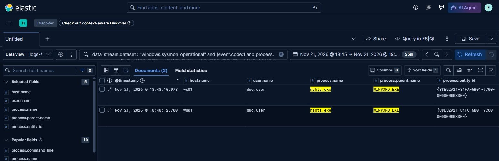
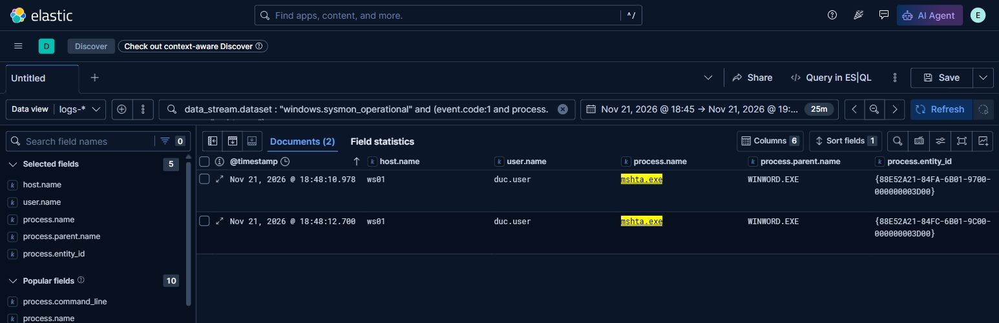
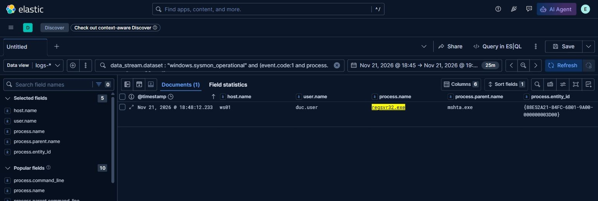
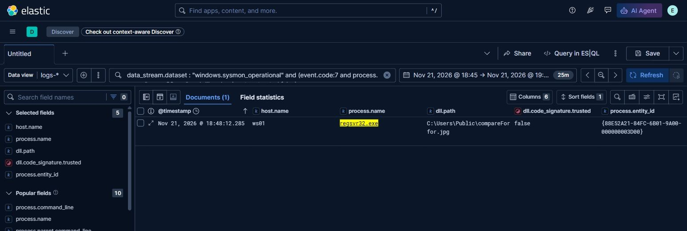
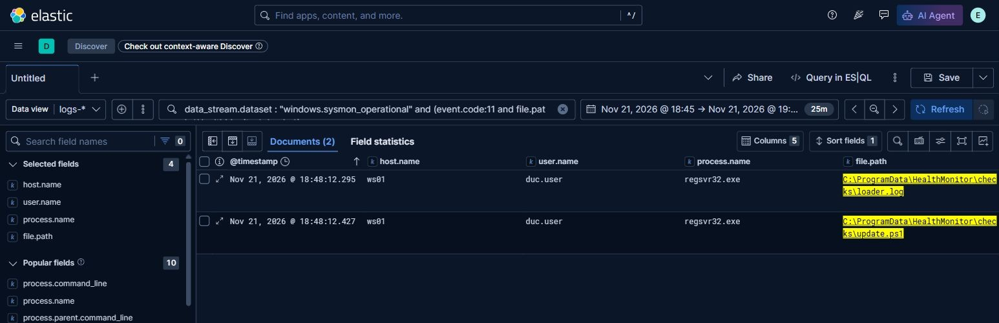
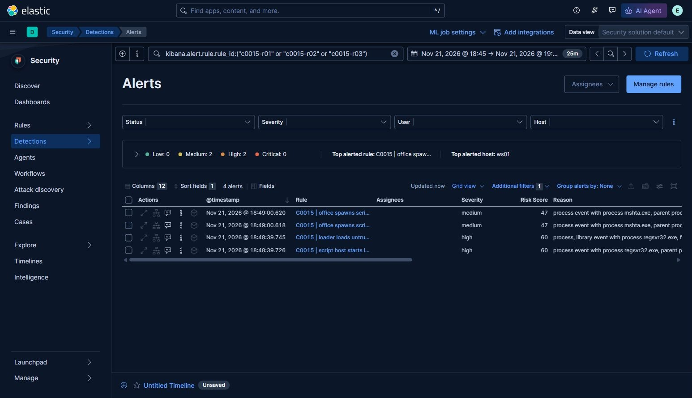

# Case 01 - Delivery: document to loader

**Run:** `run-4`, window `2026-11-21T05:00Z - 05:35Z`. This case uses run-4 only.

## Expected alerts

| Rule | Run-4 matches | What it shows |
|---|---|---|
| R01 | 2 | Word starts a script host |
| R02 | 1 | script host starts `regsvr32` |
| R03 | 1 | `regsvr32` loads an untrusted module |

## Evidence

| Step | Locator | What it shows |
|---|---|---|
| script host | `logs-windows.sysmon_operational-*` / `AaH8fO2TxY-KOm1PbsjC` | E1 `mshta.exe` under the Office chain |
| module load | `logs-windows.sysmon_operational-*` / `AaH8hO2TxY-KOm2Njkvd` | E7 for the loader, `dll.code_signature.trusted = false` |
| script write | `logs-windows.sysmon_operational-*` / `AaH8g-2TxY-KOm0gigB5` | E11 `regsvr32.exe` writes into `HealthMonitor\checks` |

R02 records the invocation of `regsvr32`; R03 records that a module was actually loaded. They are two
observations of the same step, not duplicates. Cite "untrusted" because the field is a trust verdict,
not a signature verdict.

## What it proves

A document started a shell, which started `mshta`, which started `regsvr32`, which loaded an untrusted
module from a user-writable path and wrote a script into the agent checks directory.

It does not prove the script ran (case 02) or that the module's code executed beyond the load event.

## Evidence (run-6)

Run window `2026-11-21T11:45:00Z` - `2026-11-21T12:10:00Z`. Each image is the query result for the step, in run order.

| Step | KQL | Image | What it proves |
|---:|---|---|---|
| 1 | `event.code:1 and process.parent.name:("WINWORD.EXE" or "EXCEL.EXE" or "POWERPNT.EXE" or "OUTLOOK.EXE") and process.name:("mshta.exe" or "cmd.exe" or "wscript.exe" or "cscript.exe" or "powershell.exe")` |  | Word starts a script host |
| 2 | `event.code:1 and process.name:"mshta.exe"` |  | `mshta.exe` runs the HTA |
| 3 | `event.code:1 and process.name:"regsvr32.exe"` |  | `regsvr32.exe` runs the staged `.jpg` |
| 4 | `event.code:7 and process.name:"regsvr32.exe" and dll.code_signature.trusted:false` |  | E7 shows the unsigned module load |
| 5 | `event.code:11 and file.path:*HealthMonitor*checks*` |  | The loader writes `update.ps1` into the checks folder |
| 7 | `kibana.alert.rule.rule_id:("c0015-r01" or "c0015-r02" or "c0015-r03")` |  | R01, R02 and R03 for the delivery chain |
