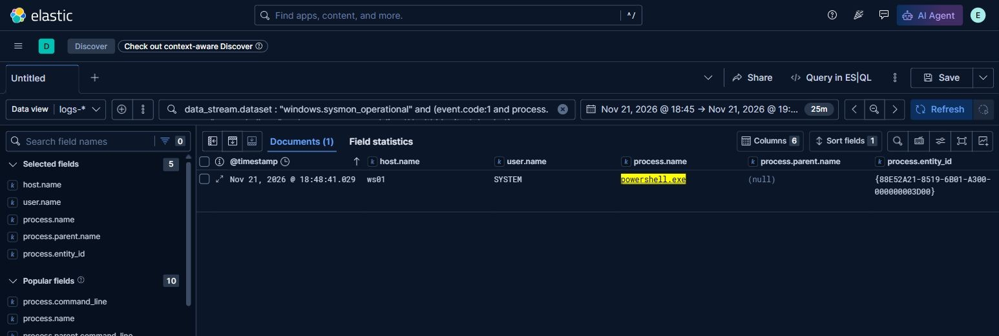
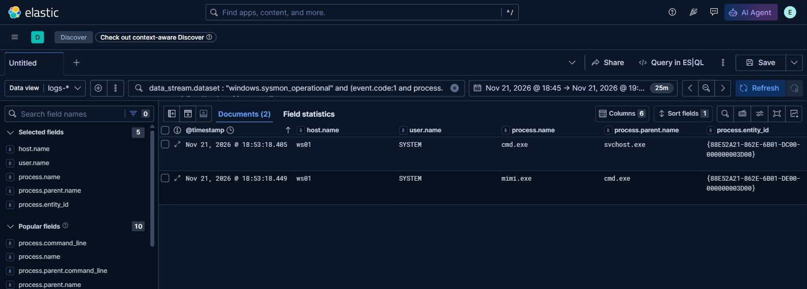
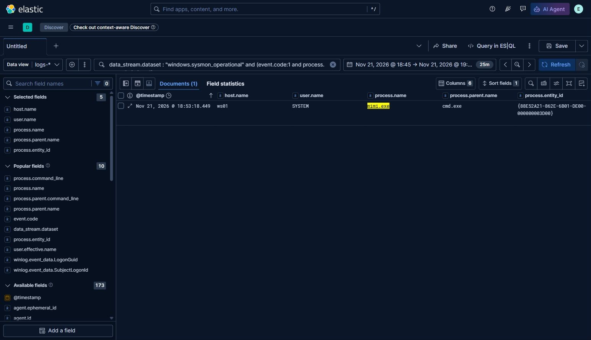
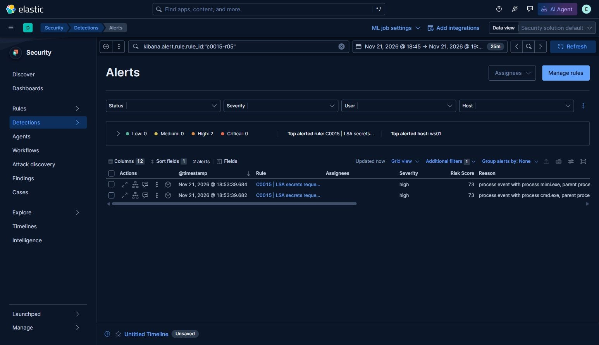

# Case 02 - Agent escalation, discovery and LSA secret

**Runs:** R05 and R18 are from `run-3` (`2026-11-20T16:45Z - 17:05Z`); R04 and R13 are from `run-4`
(`2026-11-21T05:00Z - 05:35Z`). The case states the run for each claim.

## Expected alerts

| Rule | Run | What it shows |
|---|---|---|
| R13 | run-4 | `regsvr32.exe` writes a `.ps1` into the agent checks directory |
| R04 | run-4 | PowerShell runs that script from the checks path |
| R05 | run-3 | `lsadump::secrets` is requested |
| R18 | run-3 | domain and trust discovery |

## Evidence

| Step | Locator | What it shows |
|---|---|---|
| checks write (R13) | run-4 / `AaH8g-2TxY-KOm0gigB5` | E11, writer `regsvr32.exe`, `duc.user` |
| discovery (R18) | run-3 / `AaH54ZKtksj2Z05CAh4g` | E1 `nltest /domain_trusts`; the other three hits are `net.exe`/`net1.exe` and `net view` |
| LSA secret request (R05) | run-3 / `AaH54ZKtksj2Z06SA00d` | E1 `mimi.exe ... "lsadump::secrets"` under SYSTEM |

## Ordering

In run-3, the E11 write by `regsvr32` under `duc.user` is at `16:51:10.192Z`; the PowerShell E1 under
SYSTEM is at `16:51:39.922Z`, **29.730 seconds later**. The E1 has no parent, so the link to
HealthMonitor comes from the service configuration and `agent.log`, not from the event graph.

## What it proves

A standard user reached SYSTEM through a misconfigured agent, then asked for the LSA secret of the
backup service. The **request** is the alert; the recovered `_SC_C0015Backup` value is the operator
artifact, recorded separately and redacted.

It does not prove the secret was used, or that LSASS was touched: `lsadump::secrets` is not `sekurlsa`.

## Evidence (run-6)

Run window `2026-11-21T11:45:00Z` - `2026-11-21T12:10:00Z`. Each image is the query result for the step, in run order.

| Step | KQL | Image | What it proves |
|---:|---|---|---|
| 6 | `event.code:1 and process.name:"powershell.exe" and process.command_line:*HealthMonitor*checks*` |  | The agent runs the planted script as SYSTEM |
| 13 | `kibana.alert.rule.rule_id:"c0015-r18"` |  | R18 for the discovery commands |
| 14 | `event.code:1 and process.command_line:*lsadump::secrets*` |  | `lsadump::secrets` request |
| 15 | `event.code:1 and process.name:"mimi.exe"` |  | `mimi.exe` process creation |
| 16 | `kibana.alert.rule.rule_id:"c0015-r05"` |  | R05 for the LSA secret request |
