# Case 03 - WMI, injection, persistence across reboot and impact

**Run:** `run-4`, window `2026-11-21T05:00Z - 05:35Z`. This is the reference case.

## Expected alerts

| Rule | Run-4 matches | What it shows |
|---|---|---|
| R07 | 6 | `wmic /node:FS01` from WS01 |
| R08 | 6 | WMI children on FS01 |
| R14 | 6 | remote threads into `svchost.exe` |
| R15 | 7 | module loads from the staging path |
| R16/R17 | 3 / 3 | DNS `checkauj.com` and the 443 connection from the same identity |
| R19 | 1 | `/create ... /sc onstart` |
| R10/R11/R12 | 1 / 1 / 1 | shadow copies, rclone, locker |

## Persistence timeline

| Time (UTC) | Source | What it records |
|---|---|---|
| 05:20:59.059 | E1, locator `AaH8je2TxY-KOm0HrUjG` | `schtasks /create` with `/sc onstart /ru SYSTEM` (R19; this is the create, not a query) |
| 05:20:59 | `C:\ProgramData\c0015\persist.log` | `=== persist ready ===`, task `Ready` (operator artifact) |
| 05:22:49 | operator | FS01 rebooted |
| after boot | `schtasks /query` | `Last Run` set, task ran |
| after boot | Sliver session `a796ef3b` | new beacon in `svchost.exe` (PID 788) |
| 05:29:26-05:29:28 | `fs01_task.log` | defences, injection, rclone, impact all pass |

The middle of the chain (task actually running at boot) is confirmed by the task `Last Run` and the new
`svchost` session; the E8/E7 of that new instance are part of the run-4 totals, with the full locator
list in `evidence/runs/run-4`.

## Identity

| Stage | Account |
|---|---|
| injector on WS01 | SYSTEM (agent) |
| beacon in `svchost` on WS01 | SYSTEM |
| WMI call to FS01 | `C0015\Administrator` |
| injector and beacon on FS01 | SYSTEM (`C0015\FS01$` on the network) |
| `rclone`, `vssadmin`, locker on FS01 | `C0015\Administrator` (E1 user field) |

## What it proves

The credential was used for remote execution, the beacon was placed in an existing service host, a boot
task was created by the payload and survived one reboot, and the impact steps ran after the reboot.

It does not prove persistence across task deletion, delivery to the cloud remote, or reversible
encryption. R14's six matches are three injections with two threads each, not six successful injections.

## Evidence (run-6)

Run window `2026-11-21T11:45:00Z` - `2026-11-21T12:10:00Z`. Each image is the query result for the step, in run order.

| Step | KQL | Image | What it proves |
|---:|---|---|---|
| 17 | `event.code:1 and process.name:("WMIC.exe" or "wmic.exe") and process.command_line:*process call create*` | 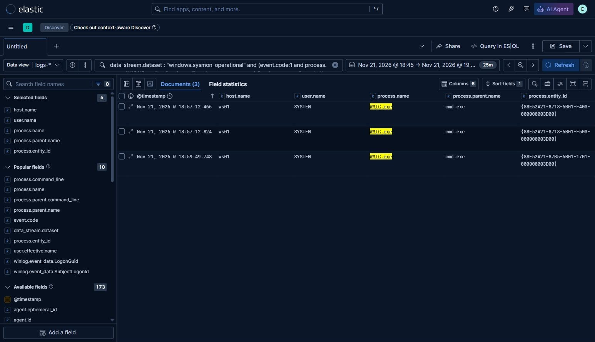 | `wmic` remote creation on WS01 |
| 18 | `event.code:1 and process.parent.name:"WmiPrvSE.exe"` | 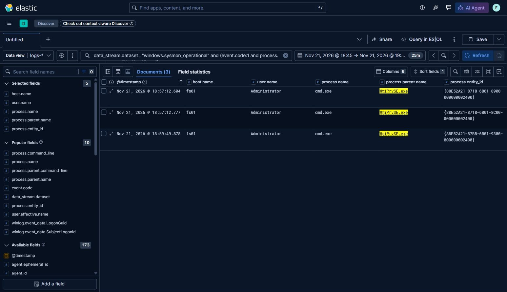 | `WmiPrvSE` child on FS01 |
| 19 | `event.code:4624 and winlog.event_data.LogonType:3 and winlog.event_data.TargetUserName:"Administrator"` | 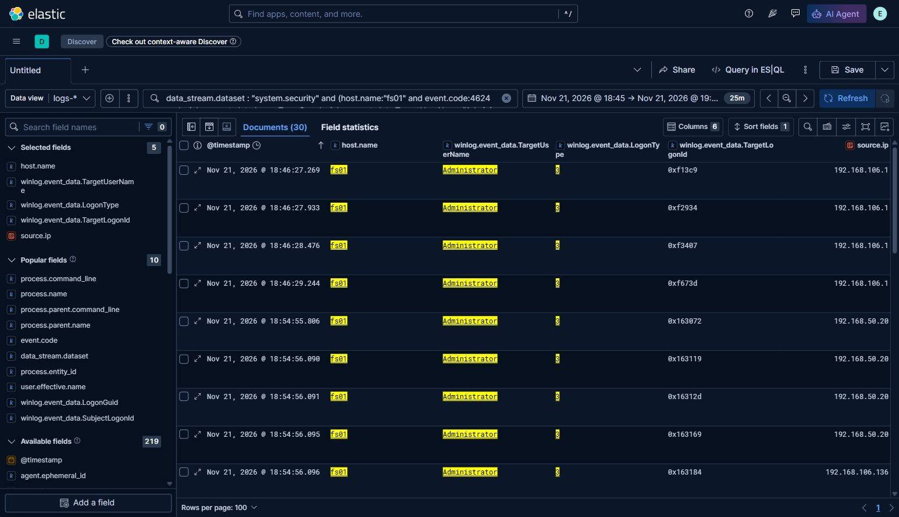 | 4624 type 3 on FS01 |
| 20 | `event.code:1 and host.name:"fs01" and process.parent.name:"WmiPrvSE.exe"` | 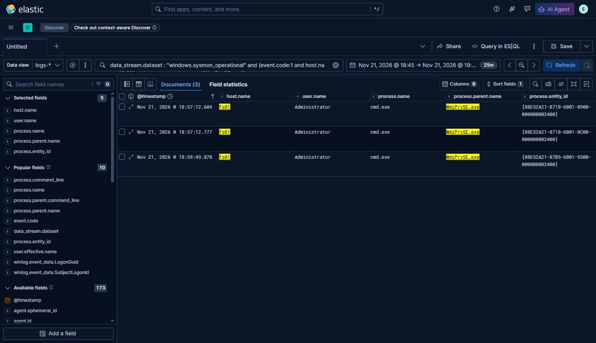 | WMI children on FS01 |
| 21 | `kibana.alert.rule.rule_id:("c0015-r07" or "c0015-r08")` | 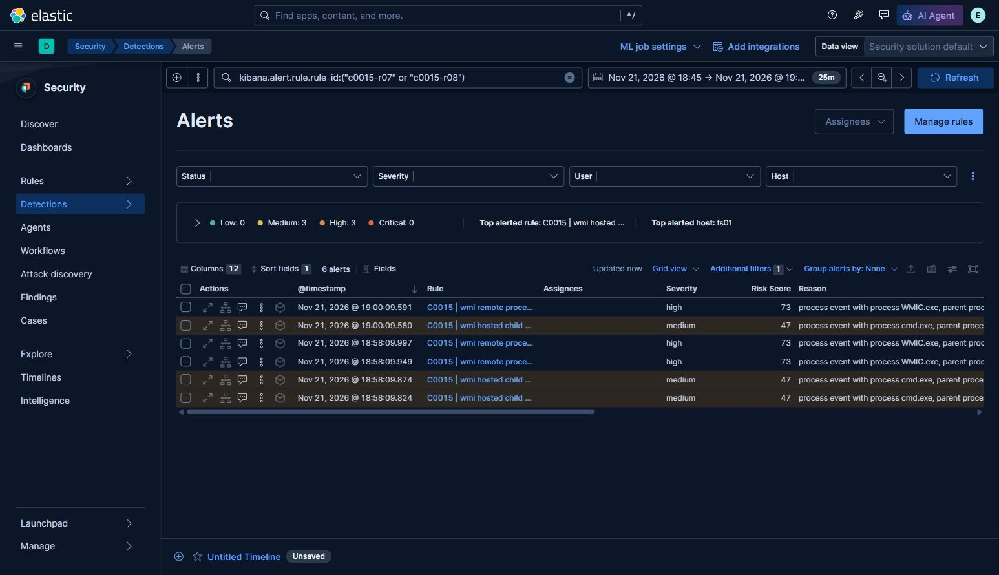 | R07 and R08 |
| 22 | `event.code:8 and process.name:"rundll32.exe" and winlog.event_data.TargetImage:*svchost.exe` | 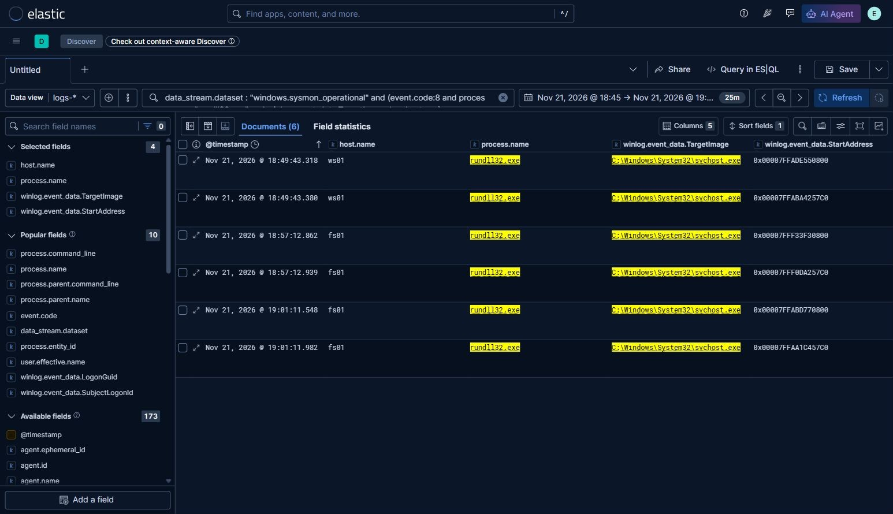 | E8 remote thread into `svchost.exe` |
| 23 | `event.code:7 and dll.path:(*ProgramData*c0015* or *ProgramData*beacon.dll)` | 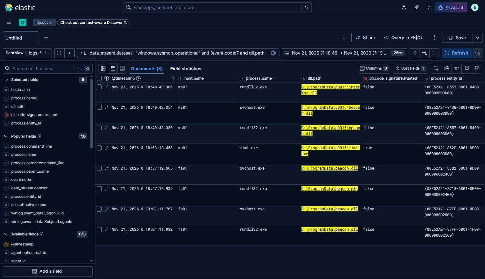 | Beacon module loaded in `svchost.exe` |
| 24 | `event.code:1 and process.name:"rundll32.exe" and process.command_line:*143.dll*` | 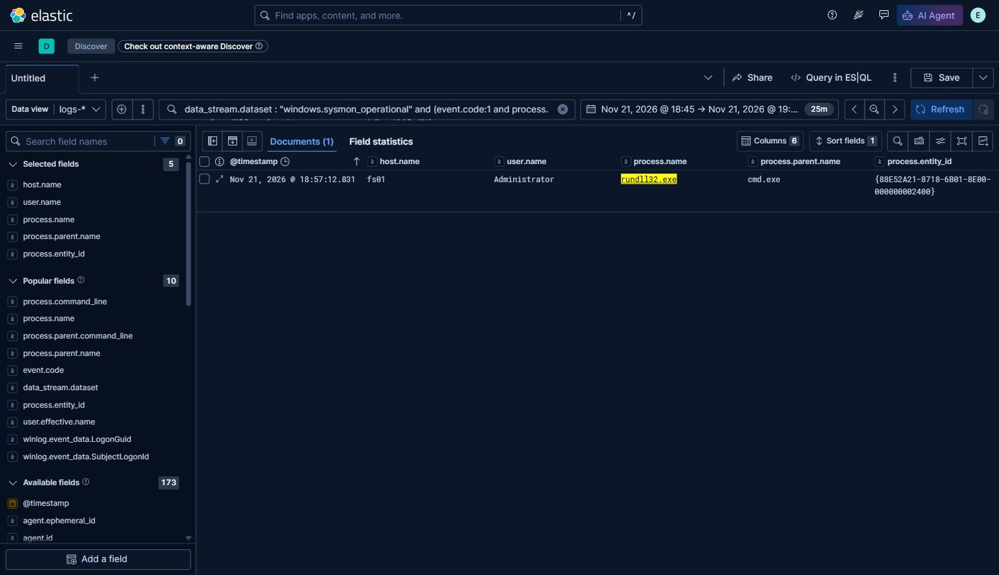 | Injector command line |
| 25 | `kibana.alert.rule.rule_id:("c0015-r14" or "c0015-r15")` | 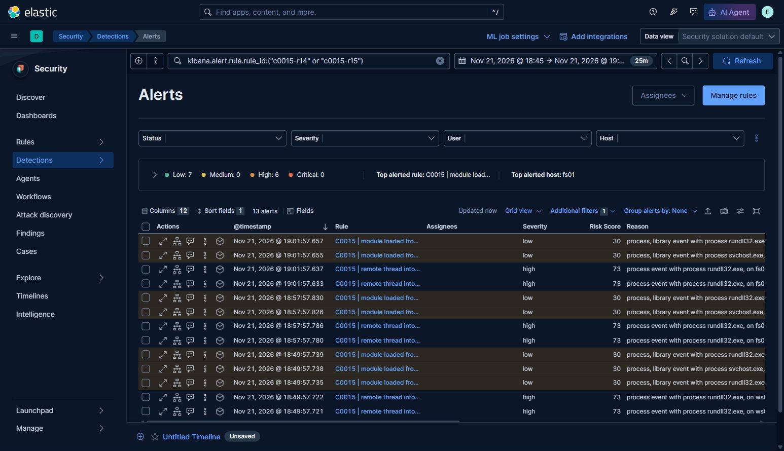 | R14 and R15 |
| 26 | `event.code:22 and dns.question.name:"checkauj.com"` | 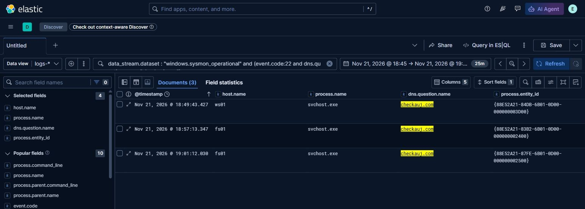 | DNS lookup for `checkauj.com` |
| 27 | `event.code:3 and destination.ip:"192.168.50.100" and destination.port:443` | 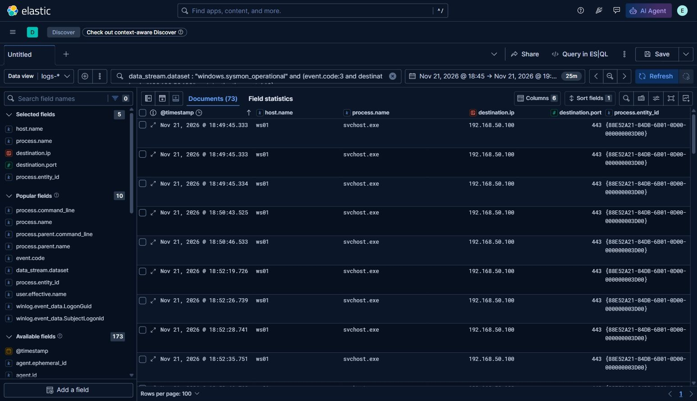 | Connection to the listener on 443 |
| 28 | `event.code:3 and process.name:"svchost.exe" and destination.port:443` | 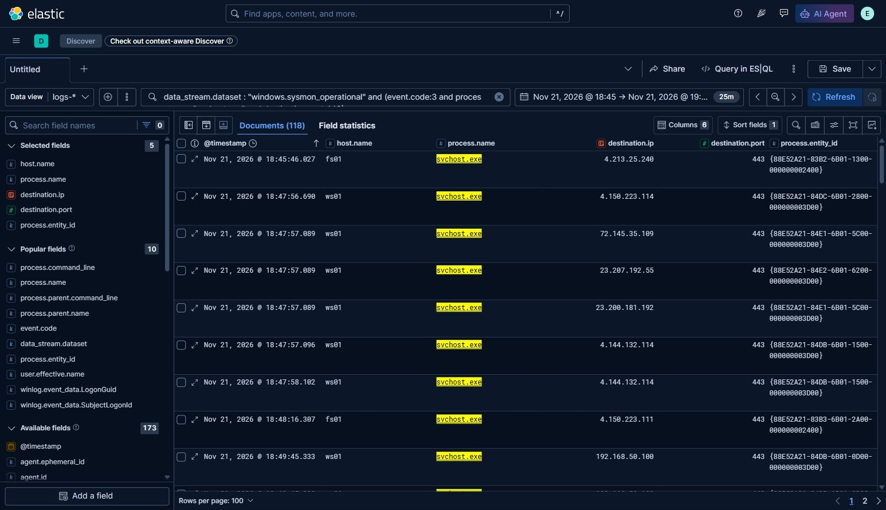 | `svchost.exe` outbound 443 |
| 29 | `kibana.alert.rule.rule_id:("c0015-r16" or "c0015-r17")` | 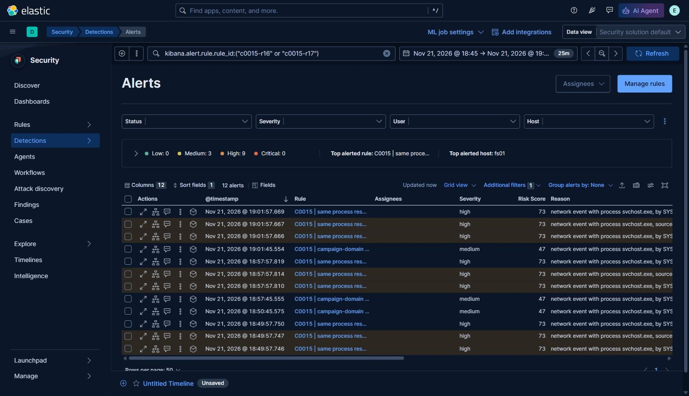 | R16 and R17 |
| 30 | `event.code:1 and process.name:"schtasks.exe" and process.command_line:*onstart*` |  | Boot task created with `/sc onstart` |
| 31 | `event.code:1 and process.command_line:*C0015Persist*` | 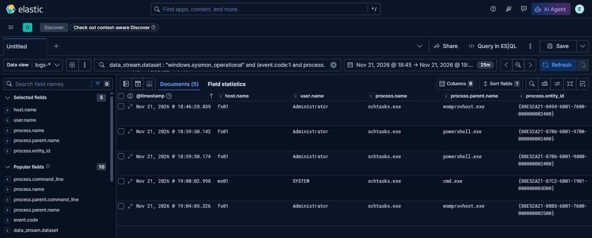 | `C0015Persist` queried by name |
| 32 | `kibana.alert.rule.rule_id:"c0015-r19"` | 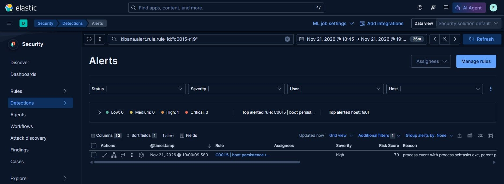 | R19 for the boot task |
| 33 | `event.code:1 and process.name:"rclone.exe"` |  | `rclone` transfer |
| 34 | `event.code:1 and process.name:"vssadmin.exe" and process.command_line:*shadows*` | 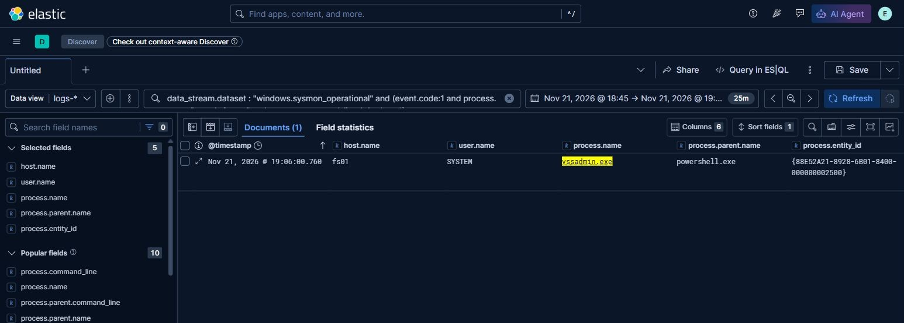 | Shadow copy deletion |
| 35 | `event.code:1 and process.name:("ransomware-sim.exe" or "locker.exe")` | 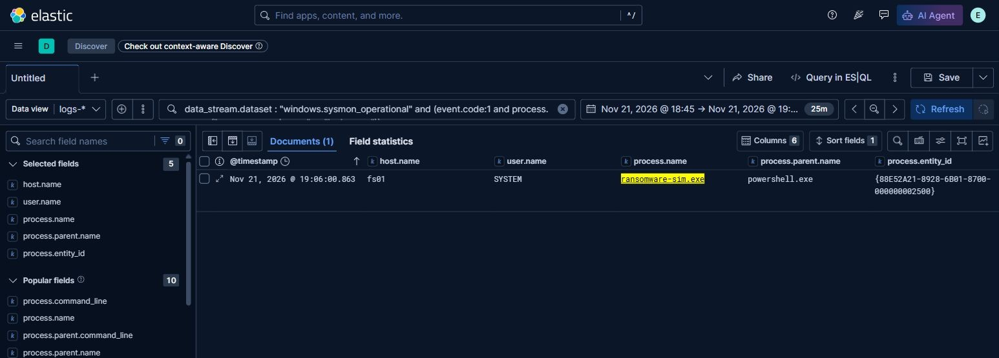 | Locker invocation |
| 36 | `event.code:11 and file.name:"readme.txt"` | 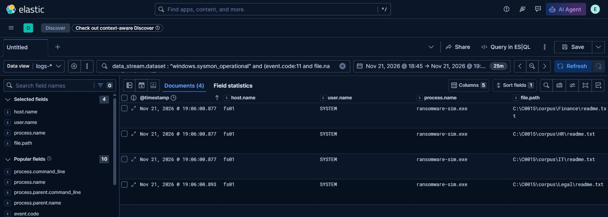 | Notes written |
| 37 | `event.code:11 and file.name:*.c0015` | 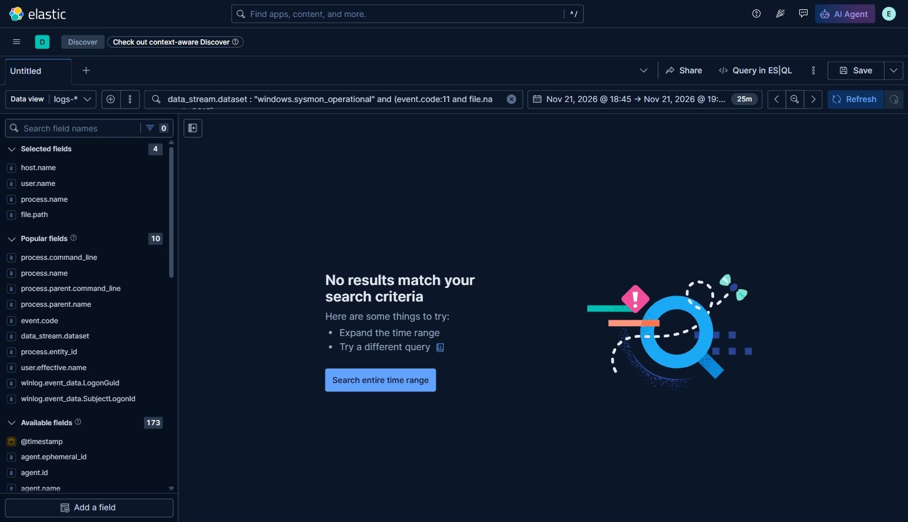 | Extension written; 0 rows in this window |
| 38 | `kibana.alert.rule.rule_id:("c0015-r10" or "c0015-r11" or "c0015-r12")` | 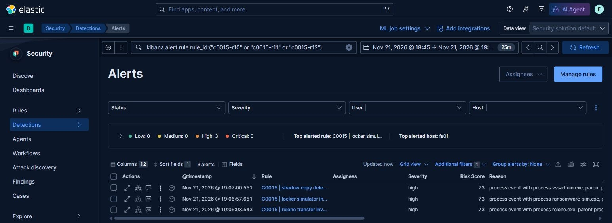 | R10, R11 and R12 |
